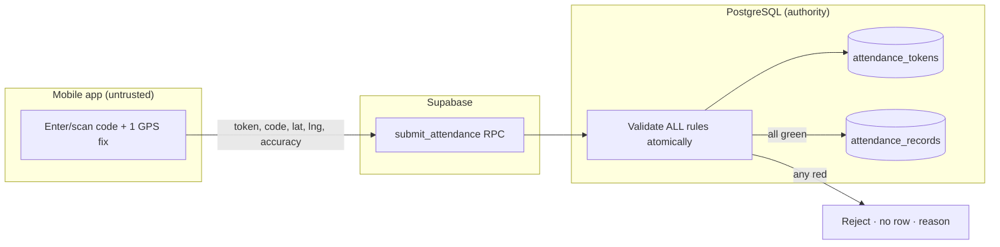

# STARS — Attendance Security Architecture

**Authoritative design + implementation plan for the STARS attendance mechanism.**
Supersedes the informal notes in [`full-challenge-mechanism.md`](./full-challenge-mechanism.md). Stack: **Expo React Native + Supabase (PostgreSQL + Auth + Edge Functions)**.

> **Non-negotiable principle:** the phone never decides that a student is present. The phone only submits *evidence*. **PostgreSQL makes the final decision** inside one atomic transaction. **Geofencing is a hard requirement on every attendance attempt — there is no path to PRESENT that skips it.**

**Status legend used throughout:** ✅ already in the codebase · 🔧 exists but must change · 🆕 to build.

Contents:
1. System Overview · 2. Attendance Security Architecture · 3. Attendance Session Lifecycle · 4. Rotating Session Code · 5. Mandatory Geofencing · 6. One-Time Attendance Tokens · 7. Server-Side Validation · 8. Supabase Database Design · 9. RLS Policies · 10. Attendance Submission RPC · 11. Expo/React Native Client Flow · 12. Offline Attendance Handling · 13. Duplicate and Replay Protection · 14. Fraud/Suspicious Activity Detection · 15. Audit Logging · 16. Error Handling · 17. Security Threats and Mitigations · 18. Testing Strategy · 19. Performance Considerations · 20. Implementation Checklist

---

## 1. System Overview

STARS marks class attendance in seconds while making forgery hard. A lecturer starts a **session** bound to a **venue** (which carries the geofence). Students open the app, allow location, and enter/scan a **rotating 6-digit code**. Everything security-critical — code validity, distance to venue, single-use token, duplicate check, timing — is decided **server-side** in a single PostgreSQL transaction. If any check fails, **no record is written** and the student sees a specific reason.

**Design goals (in priority order):** 1) hard to manipulate, 2) fast for the student (3 taps), 3) auditable, 4) works on flaky networks without weakening security.

| Layer | Responsibility |
|-------|----------------|
| **Mobile app (Expo)** | Collect evidence (code + one GPS fix), show UX-only preliminary checks, submit to Supabase, render the server's verdict. **Makes no final decision.** |
| **Supabase (Auth + Edge/RPC)** | Authenticate the caller, expose the `submit_attendance` RPC, keep secrets (session seed) out of client reach. |
| **PostgreSQL** | Enforce every rule inside an atomic transaction; enforce uniqueness and RLS at the storage layer; stamp server time. |

---

## 2. Attendance Security Architecture

Four mandatory mechanisms, layered so that defeating one is not enough:

1. **Rotating Session Code** (§4) — proves *"I am in the room right now"* (short-lived shared secret shown by the lecturer).
2. **Mandatory Geofencing** (§5) — proves *"I am physically at the venue"* (server-computed distance to the venue's stored location).
3. **One-Time Attendance Token** (§6) — proves *"this exact submission has not been replayed"* (single-use, expiring, server-issued).
4. **Server-Side Validation** (§7, §10) — the authority: a `SECURITY DEFINER` RPC re-checks **all** rules atomically and is the *only* writer of `attendance_records`.

**Trust boundary:** everything the client sends is untrusted input — including any `distance` value. The server recomputes distance from the raw GPS fix and the venue's stored coordinates. The client is told the outcome; it is never asked to be believed.



---

## 3. Attendance Session Lifecycle

| Phase | Mobile app | Supabase | PostgreSQL | On failure |
|-------|-----------|----------|------------|------------|
| **Start** | Lecturer taps *Start session*, selects the **venue**, captures one GPS fix (anchor sanity only). | RPC `start_session(module_id, venue_id)` (SECURITY DEFINER). | Insert `attendance_sessions` with server `created_at`, `expires_at = now()+duration`, a **server-generated secret `algorithm_seed`**, `venue_id`, `active=true`. | Not the module's lecturer/tutor → reject; venue missing lat/lng/polygon → reject. |
| **Live** | Lecturer screen shows the current rotating code + QR, refreshed each window. | RPC `get_active_session_code(session_id)` returns the current code to the **owning lecturer/tutor only**. | Code derived from `algorithm_seed` + server time window; seed never leaves the DB. | Non-owner calls it → reject (RLS/authz). |
| **Submit** | Students submit evidence (see §11). | `submit_attendance` RPC. | Atomic validation + insert (§10). | See §16. |
| **End** | Lecturer taps *End*. | RPC `close_session(session_id)`. | `active=false`, `ended_at=now()`; codes/tokens for the session become invalid. | — |
| **Expiry** | — | Any submit after `expires_at`. | Server rejects using **`now()`**, never the device clock. | "Session expired." |

**Status:** sessions/venues exist ✅; server-generated seed exists but is currently exposed to clients 🔧 (see §4); `start_session`/`close_session` partially exist 🔧.

---

## 4. Rotating Session Code

**Rules:** 6-digit code, **rotates every 15–30s** (default **20s**), expired codes invalid immediately, **generated and validated server-side**, students can never define or read the seed.

- **Mobile app:** the *lecturer's* app fetches the current code via `get_active_session_code` and displays it (number + QR). The *student's* app only captures whatever code the student types/scans — it performs **no** code generation and never receives the seed.
- **Supabase:** `algorithm_seed` (a high-entropy secret) is created at session start and stored on the session row. It is **excluded from every client-readable view/policy**. Only `SECURITY DEFINER` functions read it.
- **PostgreSQL:** deterministic derivation

  ```sql
  -- window = server time bucketed to the rotation interval
  create or replace function public.attendance_window(interval_seconds int default 20)
  returns bigint language sql stable as $$
    select floor(extract(epoch from now()) / interval_seconds)::bigint;
  $$;

  -- 6-digit code = HMAC(seed, window) folded to 6 digits (seed stays server-side)
  create or replace function public.session_code(p_seed text, p_window bigint)
  returns text language sql immutable as $$
    select lpad((('x' || substr(encode(hmac(p_window::text, p_seed, 'sha256'),'hex'),1,8))::bit(32)::bigint % 1000000)::text, 6, '0');
  $$;
  ```

  Validation accepts the **current** window and the immediately **previous** window only (one interval of clock-skew tolerance) — never a wider range.
- **On failure:** wrong/old code → `RAISE EXCEPTION 'INVALID_CODE'`; the transaction rolls back and nothing is written.

**Change from current:** today the 6-digit code rotates every **5s** and is derived **on the client** from an `algorithm_seed` that is returned to the client (`src/utils/rotatingCode.ts`, `attendanceChallengeService`). 🔧 Move derivation server-side, widen to 20s, and stop exposing the seed. The pure client helper may remain **only** for the lecturer's display convenience, never for validation.

---

## 5. Mandatory Geofencing

**Geofencing is a hard requirement applied to *every* attendance attempt (rotating-code, QR, offline-sync, and any future method). There is no bypass and no fallback that accepts attendance without a successful geofence check.**

- **Mobile app:** obtains **one** location fix during the attempt (`expo-location`, high accuracy). It may show a *preliminary, UX-only* "you appear to be in range" hint, but this is advisory. It sends `latitude`, `longitude`, `accuracy`, `captured_at` — **not** a distance.
- **Supabase:** passes the raw fix into the RPC; never trusts a client `distance`.
- **PostgreSQL:** the venue stores the geofence (`venues.location_type` = `point` with `latitude`/`longitude`/`radius_meters`, or `polygon` with `polygon_coordinates`). The server computes distance itself:
  - **point:** Haversine distance ≤ `radius_meters`.
  - **polygon:** point-in-polygon test against `polygon_coordinates`.
- **GPS quality rules (documented and enforced):**
  - **Accuracy gate:** reject if `accuracy` is missing or worse than a threshold (e.g. `> 100 m`) — a fix too fuzzy to trust.
  - **Staleness gate:** reject if `captured_at` is older than a small window (e.g. `> 60 s` before server receipt) — the fix must be from *this* attempt.
  - **Permission/unavailable:** if the OS denies location or returns no fix, the client cannot submit and the server never receives evidence → **not accepted** (there is no "assume present").
  - **Suspicious data:** null/0,0 coordinates, impossible jumps, or an accuracy of exactly 0 are flagged and rejected/scored (see §14).
- **On failure:** out of radius/polygon, bad accuracy, stale, or missing location → `RAISE EXCEPTION 'GEOFENCE_FAILED'` (with a sub-reason) → no record.

**Status:** the venue geofence schema exists ✅ and the current Edge Function already computes **server-side Haversine** ✅; polygon support, accuracy/staleness gates, and "no distance from client" must be made explicit and universal 🔧.

---

## 6. One-Time Attendance Tokens

**Rules:** every successful attempt consumes a **unique, server-generated, expiring, single-use** token; replays fail; duplicates are rejected at the DB level.

- **Mobile app:** when the student opens attendance and has a location fix, it calls `begin_attendance(session_id)` and receives an opaque `token`. It submits that token with the evidence. It cannot mint tokens.
- **Supabase / PostgreSQL:** `begin_attendance` (SECURITY DEFINER) inserts a row into `attendance_tokens` after preliminary auth/enrolment/active-session checks and returns the token id. `submit_attendance` **locks and consumes** it.

  ```sql
  create table public.attendance_tokens (
    token         text primary key default gen_random_uuid()::text,
    session_id    text not null references public.attendance_sessions(id) on delete cascade,
    student_id    text not null,
    issued_at     timestamptz not null default now(),
    expires_at    timestamptz not null default now() + interval '90 seconds',
    consumed_at   timestamptz,                 -- null = unused
    consumed_record_id text,                   -- links to the attendance row on success
    attempts      int not null default 0
  );
  create index on public.attendance_tokens (session_id, student_id) where consumed_at is null;
  ```

- **On failure:** token unknown / expired (`now() > expires_at`) / already `consumed_at` → `RAISE EXCEPTION 'TOKEN_INVALID'`. A **replayed** consumed token always fails. Wrong-code retries increment `attempts`; past a small cap the token is burned (`consumed_at = now()` with no record) to stop brute force.

**Status:** 🆕 new — no token table exists today.

---

## 7. Server-Side Validation

The app **never** makes the final decision. It submits evidence; PostgreSQL validates. The RPC checks, at minimum, **all** of the following before any insert:

| # | Check | Enforced by |
|---|-------|-------------|
| 1 | Authenticated user (`auth.uid()` present) | Supabase Auth + RPC |
| 2 | Caller maps to a **student** account | RPC (join `user_profiles`) |
| 3 | Student **enrolled** in the session's module | RPC (`modules.enrolled_students`) |
| 4 | Session **exists and is active** | RPC |
| 5 | Session **not expired** (`now() < expires_at`) | RPC (server time) |
| 6 | **Rotating code** valid for current/previous window | RPC (§4) |
| 7 | **Mandatory geofence** pass (point/polygon) | RPC (§5) |
| 8 | **GPS validity/accuracy** within gates | RPC (§5) |
| 9 | **One-time token** unconsumed + unexpired | RPC + row lock (§6) |
| 10 | **No duplicate** for (session, student) / (session, device) | DB `UNIQUE` constraint |
| 11 | **Attendance time window** (within session open period, optional grace) | RPC |
| 12 | **session ↔ module ↔ venue** relationship consistent | RPC (FK + explicit check) |

All twelve run inside **one transaction**. Any failure → `RAISE EXCEPTION` → full rollback → no partial state.

---

## 8. Supabase Database Design

Existing (✅): `venues` (point/polygon geofence), `attendance_sessions` (`venue_id`, `algorithm_seed`, `active`, `created_at`, `expires_at`, `ended_at`, `radius`, `lecturer_location`), `attendance_records` (`session_id`, `student_id`, `device_id`, `timestamp`, `distance`, `passed`, `verified`, …) with **`UNIQUE(session_id, device_id)`** ✅.

Add / change:
- 🆕 `attendance_tokens` (§6).
- 🆕 `attendance_records` columns for audit: `venue_id`, `submitted_latitude`, `submitted_longitude`, `gps_accuracy`, `server_distance_meters`, `code_window`, `token` (FK), `client_captured_at`, `server_recorded_at default now()`.
- 🔧 add **`UNIQUE(session_id, student_id)`** alongside the existing device-uniqueness (a student can't be marked twice even from two devices).
- 🔧 mark `algorithm_seed` as server-only (never in a student-readable view/policy).
- Keep **server timestamps** authoritative: `server_recorded_at default now()`; store the client's `client_captured_at` only as evidence, never as the source of truth.

---

## 9. RLS Policies

RLS is ON for every attendance table; the writing path is the `SECURITY DEFINER` RPC (which runs as owner and bypasses table grants), so students have **no** direct write access.

| Table | student (`authenticated`) | anon | Write path |
|-------|---------------------------|------|-----------|
| `attendance_records` | `SELECT` own rows only (`student_id = my id`) | none | **Only** `submit_attendance` (definer) inserts. No client `INSERT/UPDATE/DELETE`. |
| `attendance_sessions` | `SELECT` **non-secret** columns of sessions for enrolled modules (a view that **excludes `algorithm_seed`**) | none | lecturer/tutor RPCs only |
| `attendance_tokens` | none directly | none | `begin_attendance` / `submit_attendance` only |
| `venues` | `SELECT` (read geofence) | none | admin only |
| `audit_logs` | `SELECT` scoped by role (see cross-ref) | **none** | definer/authenticated insert only |

> **Cross-reference:** `audit_logs` currently has RLS disabled with full anon grants (**SEC-001**, critical). Fix is staged in `supabase/migrations/20260907093000_secure_audit_logs.sql` and must be applied. Attendance tables must not repeat that mistake — verify with security tests TC-S1/TC-S2.

- **On failure:** a student calling `INSERT` on `attendance_records` directly → `42501` RLS violation (already verified: anon insert returns 401). Enrolment/ownership violations inside the RPC → exception.

---

## 10. Attendance Submission RPC

Single atomic authority. Sketch (illustrative — final column names per §8):

```sql
create or replace function public.submit_attendance(
  p_token     text,
  p_code      text,
  p_latitude  numeric,
  p_longitude numeric,
  p_accuracy  numeric,
  p_captured_at timestamptz,
  p_device_id text
) returns jsonb
language plpgsql security definer set search_path = public as $$
declare
  v_uid uuid := auth.uid();
  v_student text;
  v_tok  attendance_tokens%rowtype;
  v_sess attendance_sessions%rowtype;
  v_ven  venues%rowtype;
  v_dist numeric;
  v_rec_id text;
begin
  if v_uid is null then raise exception 'NOT_AUTHENTICATED'; end if;

  -- resolve + lock the one-time token (serialises concurrent submits)
  select * into v_tok from attendance_tokens where token = p_token for update;
  if not found or v_tok.consumed_at is not null or now() > v_tok.expires_at
    then raise exception 'TOKEN_INVALID'; end if;

  select linked_student_id into v_student from user_profiles where id = v_uid and role = 'student';
  if v_student is null or v_student <> v_tok.student_id then raise exception 'NOT_STUDENT'; end if;

  select * into v_sess from attendance_sessions where id = v_tok.session_id;
  if not found or not v_sess.active or now() >= v_sess.expires_at then raise exception 'SESSION_INACTIVE'; end if;

  -- enrolment (student must be in the session's module)
  if not exists (select 1 from modules m
                 where m.id = v_sess.module_id
                   and m.enrolled_students ? v_student) then raise exception 'NOT_ENROLLED'; end if;

  -- rotating code: current or previous window only
  if p_code <> session_code(v_sess.algorithm_seed, attendance_window())
     and p_code <> session_code(v_sess.algorithm_seed, attendance_window() - 1)
     then update attendance_tokens set attempts = attempts + 1 where token = p_token;
          raise exception 'INVALID_CODE'; end if;

  -- MANDATORY geofence — server computes distance, never the client
  if p_latitude is null or p_longitude is null or p_accuracy is null or p_accuracy > 100
     then raise exception 'GPS_INVALID'; end if;
  if p_captured_at is null or p_captured_at < now() - interval '60 seconds'
     then raise exception 'GPS_STALE'; end if;

  select * into v_ven from venues where id = v_sess.venue_id;
  if not found then raise exception 'VENUE_MISSING'; end if;
  v_dist := haversine_m(p_latitude, p_longitude, v_ven.latitude, v_ven.longitude);   -- or polygon test
  if v_dist > coalesce(v_ven.radius_meters, 50) then raise exception 'GEOFENCE_FAILED'; end if;

  -- insert (UNIQUE(session_id,student_id) + UNIQUE(session_id,device_id) block duplicates atomically)
  v_rec_id := gen_random_uuid()::text;
  insert into attendance_records(id, session_id, student_id, device_id, venue_id,
      submitted_latitude, submitted_longitude, gps_accuracy, server_distance_meters,
      code_window, token, client_captured_at, server_recorded_at, passed, verified)
    values (v_rec_id, v_sess.id, v_student, p_device_id, v_ven.id,
      p_latitude, p_longitude, p_accuracy, v_dist,
      attendance_window(), p_token, p_captured_at, now(), true, true);

  update attendance_tokens set consumed_at = now(), consumed_record_id = v_rec_id where token = p_token;
  return jsonb_build_object('status','PRESENT','record_id',v_rec_id,'distance_m',round(v_dist,1));
exception
  when unique_violation then raise exception 'DUPLICATE_ATTENDANCE';
end;
$$;
```

- **Mobile app:** calls `supabase.rpc('submit_attendance', {...})`; renders `PRESENT` or the mapped error.
- **Supabase:** runs it as definer with the student's `auth.uid()`.
- **PostgreSQL:** the transaction is the single source of truth; `FOR UPDATE` on the token serialises races; unique constraints are the last line of defence.
- **On failure:** any `RAISE` rolls the whole thing back; the token is not consumed (except the brute-force burn) and no record exists.

**Status:** 🔧 today the Edge Function verifies and the **client** then writes the record (`saveRecord`). Move the write into this atomic RPC so the client never inserts.

---

## 11. Expo/React Native Client Flow

Kept deliberately simple — three student actions, all heavy lifting server-side.

```
Student opens attendance
 → Authentication verified            (Supabase session; else route to login)
 → Active session retrieved           (read-only, no seed)
 → Student location obtained          (expo-location, high accuracy, one fix)
 → Mandatory geofence validation      (server is authority; client shows UX hint only)
 → Student enters/scans rotating code (6 digits or QR)
 → Server validates rotating code
 → Server generates/validates one-time token
 → Server performs final geofence validation
 → Server checks all security rules   (§7)
 → Database transaction records attendance
 → Attendance marked PRESENT
```

- **Mobile app:** `begin_attendance` → capture GPS + code → `submit_attendance`. Show a spinner, then the verdict. Never compute distance or codes for validation.
- **Supabase:** two RPC calls.
- **PostgreSQL:** decides.
- **On failure:** the specific error (§16) is shown with a retry affordance where safe (wrong code) or a hard stop (out of area).

---

## 12. Offline Attendance Handling

**Offline attendance must NOT bypass geofencing or any other rule.** Offline only delays submission; it never relaxes validation.

- **Mobile app:** if the network is down at submit time, queue an **evidence bundle** in the local outbox: `{ session_id, code, latitude, longitude, accuracy, client_captured_at, device_id }` plus a locally-issued attempt id. Do **not** mark the student present locally — show "pending sync".
- **Supabase / PostgreSQL:** on reconnect the outbox replays `submit_attendance` with the **stored** evidence. The server validates *everything* against **server time at sync**:
  - session still active / within an allowed **late-sync grace** window (configurable; outside it → reject);
  - geofence recomputed from the **stored** GPS fix (the fix's `client_captured_at` must fall inside the session's live window, else `GPS_STALE`);
  - rotating code validated against the **window the evidence was captured in** (server stores enough to recompute; a code captured while genuinely in the room remains valid for its own window only);
  - one-time token / duplicate / enrolment as normal.
- **On failure:** the queued item is rejected with a reason and surfaced to the student; it is never silently accepted.

**Status:** 🔧 an offline outbox scaffold exists (`src/services/offline/*`); it must route through `submit_attendance` and carry full location evidence.

---

## 13. Duplicate and Replay Protection

| Vector | Defence | Layer |
|--------|---------|-------|
| Same student marked twice | `UNIQUE(session_id, student_id)` 🔧 | PostgreSQL |
| Two devices, one student | `UNIQUE(session_id, device_id)` ✅ + student-uniqueness | PostgreSQL |
| Replay a captured submission | one-time token `consumed_at` (§6) | PostgreSQL |
| Concurrent double-tap / race | `SELECT … FOR UPDATE` on the token + unique constraints in one transaction | PostgreSQL |
| Old code reuse | window-limited code validation (current/previous only) | RPC |

- **On failure:** `unique_violation` → mapped to `DUPLICATE_ATTENDANCE`; consumed token → `TOKEN_INVALID`. No second row is ever created.

---

## 14. Fraud / Suspicious Activity Detection

Signals recorded on every record for later investigation (not all block automatically):
- server distance vs radius (near-edge or improbably-precise `accuracy=0`);
- GPS accuracy value and staleness;
- multiple `attempts` on a token, or many failed submits from one device/student;
- the same `device_id` submitting for **different** students in one session (proxy attendance);
- impossible movement (two venues far apart within minutes);
- code accepted only via previous window repeatedly (possible relay).

- **Mobile app:** nothing — detection is server/DB and analytics.
- **Supabase/PostgreSQL:** store the evidence columns (§8); a scheduled query / view flags outliers for staff.
- **On failure/flag:** hard signals (null island, impossible jump) reject inline; soft signals are logged for review, never auto-accepted.

---

## 15. Audit Logging

Every attendance decision is traceable. `attendance_records` itself carries the forensic fields (§8: submitted lat/lng, accuracy, server distance, code window, token, client vs server timestamps). Governance events (session start/close, delegations, overrides) go to `audit_logs` with **server timestamps**.

- **Mobile app:** none.
- **Supabase/PostgreSQL:** the RPC writes the record with full evidence; `insert_audit_log` records session lifecycle.
- **On failure:** rejections can be logged (reason + evidence) without creating an attendance row, so absence of a record is itself explainable.
- **Cross-reference:** lock down `audit_logs` (SEC-001) before relying on it.

---

## 16. Error Handling

Every server rejection maps to one code and a friendly message; the app shows the message and the right next step. The student never sees a raw SQL error, and a failure **never** falls through to PRESENT.

| Server code | Student sees | Retry? |
|-------------|--------------|--------|
| `NOT_AUTHENTICATED` | "Please sign in again." | re-login |
| `NOT_STUDENT` / `NOT_ENROLLED` | "You're not enrolled in this class." | no |
| `SESSION_INACTIVE` | "This session has ended." | no |
| `INVALID_CODE` | "That code isn't current — check the screen." | yes |
| `GPS_INVALID` / `GPS_STALE` | "We couldn't confirm your location. Move into the room and retry." | yes |
| `GEOFENCE_FAILED` | "You're not inside the venue." | yes (when in range) |
| `TOKEN_INVALID` | "Your attempt expired — tap Attend again." | restart attempt |
| `DUPLICATE_ATTENDANCE` | "You're already marked present." | no |

---

## 17. Security Threats and Mitigations

| Threat | Mitigation |
|--------|-----------|
| Student shares the code with an absent friend | Absent friend still fails **geofence** (mandatory) + one-time token per attempt |
| Forged/edited `distance` from a patched client | Server ignores client distance; recomputes from raw GPS + venue |
| GPS spoofing app | Accuracy/staleness gates + suspicious-data flags (§14); values stored for audit |
| Replaying a captured request | One-time token + `consumed_at` + unique constraints |
| Reading the seed to precompute codes | Seed is server-only; excluded from all student-readable policies/views |
| Direct DB insert with the anon key | RLS: no client write on `attendance_records`; write only via definer RPC (verified: anon `INSERT` → 401) |
| Race / double submit | Atomic transaction + `FOR UPDATE` + unique constraints |
| Device clock tampering | Server uses `now()`; client timestamp is evidence only |
| Offline "grace" abuse | Offline replays full validation at sync; outside grace → rejected |

---

## 18. Testing Strategy

Ties into the team test stories ([TEST_CASE_STORIES.md](./TEST_CASE_STORIES.md), [SECURITY_TEST_STORIES.md](./SECURITY_TEST_STORIES.md)):
- **Unit (PostgreSQL):** `session_code` determinism; window boundaries; Haversine/polygon correctness; token single-use.
- **Functional:** happy path → PRESENT; wrong code, out-of-radius, stale GPS, denied permission → each rejected with the right code.
- **Security (backend):** anon/student cannot `INSERT` `attendance_records`; cannot read `algorithm_seed`; forged distance ignored; replay fails (extends TC-S1/S2/S3).
- **Concurrency:** fire N simultaneous `submit_attendance` for one student → exactly one row (extends the stress script `scripts/stress-test-rpc.mjs`).
- **Offline:** queue an evidence bundle, sync, assert full validation still applies.

---

## 19. Performance Considerations

- Student cost is **two RPC round-trips** (`begin_attendance`, `submit_attendance`) + **one** GPS fix — no per-tick server writes for the rotating code (code is derived, not stored per window).
- Index `attendance_tokens(session_id, student_id) where consumed_at is null` and rely on the existing unique indexes for fast duplicate rejection.
- `submit_attendance` is short and set-based; the `FOR UPDATE` lock is held for microseconds.
- Live lecturer code display is a cheap read (`get_active_session_code`) polled once per window (~20s), not a subscription.
- Geofence math is pure arithmetic in-DB; no external calls on the hot path.

---

## 20. Implementation Checklist

**Database (PostgreSQL)**
- [ ] 🆕 `attendance_tokens` table + partial index (§6)
- [ ] 🆕 audit/evidence columns on `attendance_records` (§8)
- [ ] 🔧 add `UNIQUE(session_id, student_id)` (§13)
- [ ] 🆕 `attendance_window()` + `session_code()` functions (§4)
- [ ] 🆕 `begin_attendance()` and `submit_attendance()` RPCs (§10)
- [ ] 🔧 restrict `algorithm_seed` to server-only; student-readable session **view** without it (§9)

**RLS**
- [ ] 🔧 `attendance_records`: student `SELECT` own only; no client writes (§9)
- [ ] 🆕 `attendance_tokens`: no direct client access
- [ ] ⛔ apply the pending `audit_logs` fix (SEC-001) first

**Supabase / Edge**
- [ ] 🔧 move the final write out of the client into `submit_attendance`
- [ ] 🔧 keep `verify-attendance-record` logic in-DB or call it from the RPC (single authority)

**Expo client**
- [ ] 🔧 rotating code: display only (lecturer), no client-side validation
- [ ] 🔧 attendance flow → `begin_attendance` → GPS + code → `submit_attendance`
- [ ] 🔧 offline outbox routes through `submit_attendance` with full location evidence (§12)
- [ ] 🔧 map server error codes to friendly copy (§16)

**Testing**
- [ ] 🆕 SQL unit tests for code/window/geofence/token
- [ ] 🔧 extend security + stress + offline tests (§18)

---

*Every attendance record must pass geofence validation before it can be marked PRESENT. Geofencing is a hard requirement — never optional, secondary, or a fallback.*
