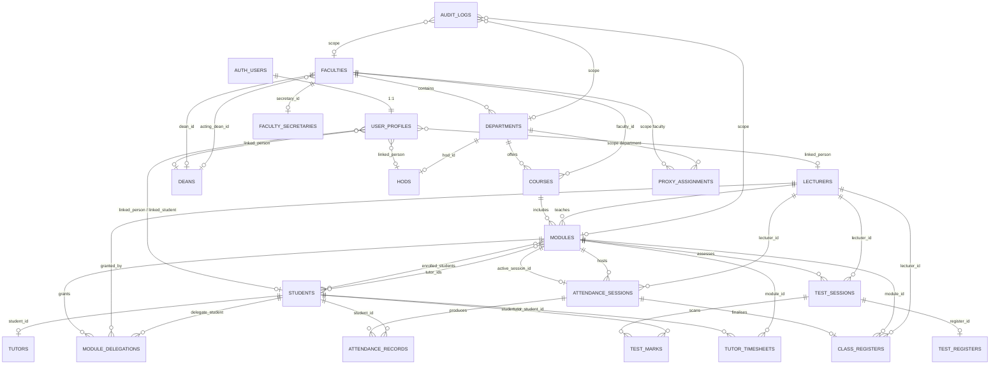
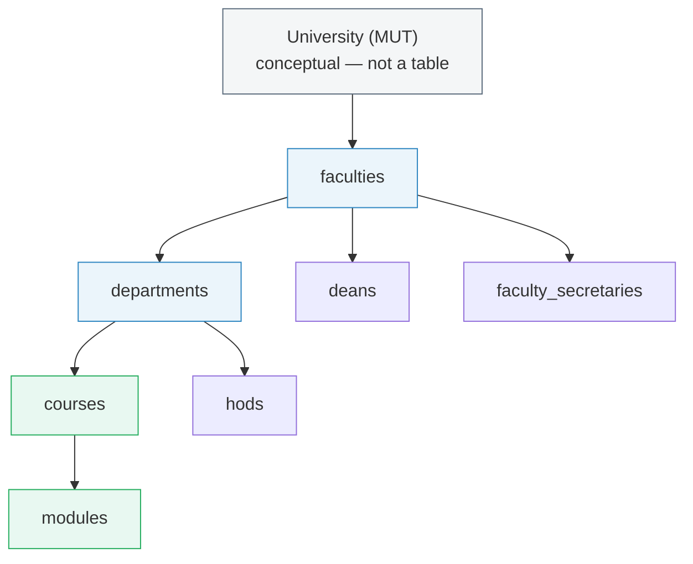
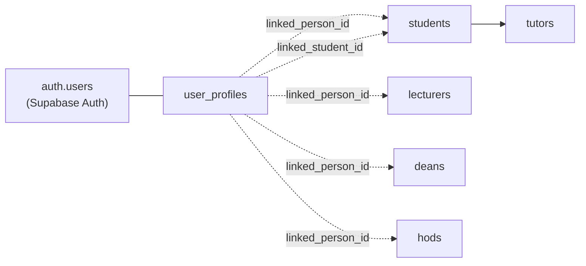
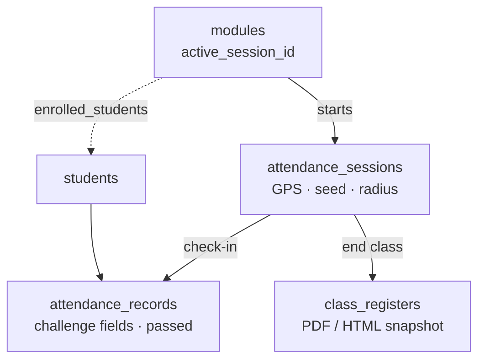
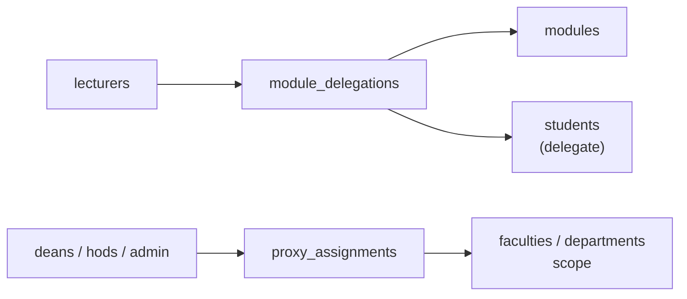
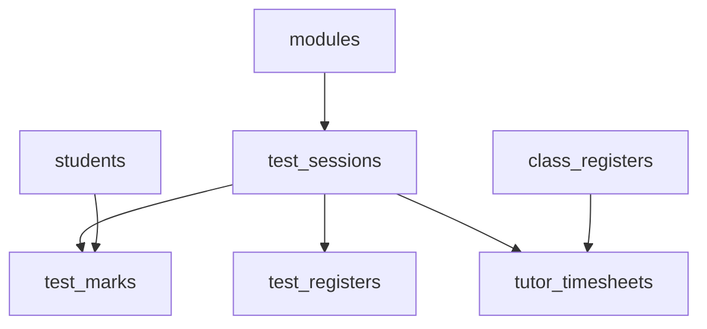
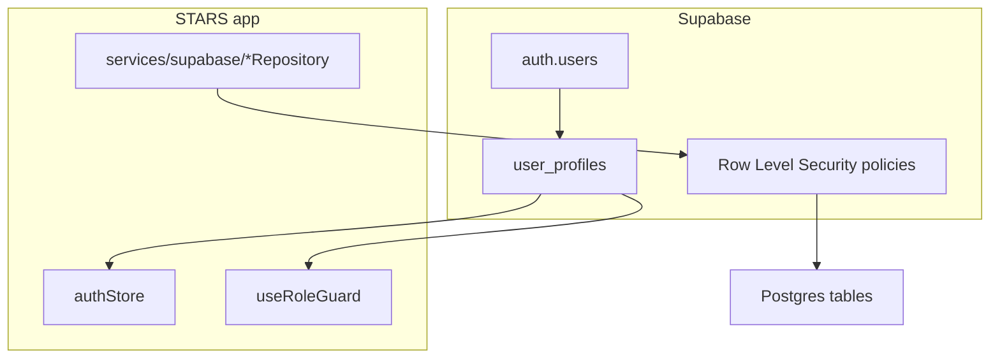

# STARS — Database schema documentation

Postgres schema for **Supabase** (live backend) aligned with the mock DB (`src/mockDB/`) and TypeScript models (`src/models/`).

**Related:** [SUPABASE_INTEGRATION.md](./SUPABASE_INTEGRATION.md#m0--integration-sprint-start-here) (M0 integration stories first) · [INSTITUTION_HIERARCHY.md](./INSTITUTION_HIERARCHY.md) · [full-challenge-mechanism.md](./full-challenge-mechanism.md) · `src/supabase/tables.ts`

---

## Conventions

| Topic | Rule |
|--------|------|
| **Postgres table names** | snake_case — see `TABLES` in `src/supabase/tables.ts` |
| **Column names (DB)** | snake_case |
| **App models (TS)** | camelCase — converted by `toRow` / `fromRow` in `src/supabase/mappers/` |
| **Primary keys** | `id` — `text` in mock; recommend `uuid` or `text` in Postgres (keep stable demo ids if migrating) |
| **Timestamps** | `created_at`, `updated_at` (`timestamptz`) where `WithTimestamps` applies |
| **Denormalised arrays** | Mock stores `string[]` on rows (e.g. `enrolled_students`); in Postgres use `jsonb` or junction tables (document choice per table) |
| **Auth identity** | `user_profiles.id` = Supabase `auth.users.id` |

---

## 1. Full entity-relationship diagram (connections)



---

## 2. Domain views (presentation diagrams)

### 2.1 Institution hierarchy



### 2.2 People & identity



### 2.3 Attendance & challenge check-in



### 2.4 Governance (delegation & proxy)



### 2.5 Assessment (tests & payroll)



---

## 3. Table catalogue

Logical key → Postgres table name (`src/supabase/tables.ts`):

| Logical key | Postgres table | TypeScript model |
|-------------|----------------|------------------|
| `faculties` | `faculties` | `FacultyModel` |
| `departments` | `departments` | `DepartmentModel` |
| `deans` | `deans` | `DeanModel` |
| `hods` | `hods` | `HodModel` |
| `facultySecretaries` | `faculty_secretaries` | `FacultySecretaryModel` |
| `courses` | `courses` | `CourseModel` |
| `modules` | `modules` | `ModuleModel` |
| `lecturers` | `lecturers` | `LecturerModel` |
| `students` | `students` | `StudentModel` |
| `tutors` | `tutors` | `TutorModel` |
| `userProfiles` | `user_profiles` | `SupabaseUserProfileDoc` |
| `moduleDelegations` | `module_delegations` | `ModuleDelegationModel` |
| `proxyAssignments` | `proxy_assignments` | `ProxyAssignmentModel` |
| `attendanceSessions` | `attendance_sessions` | `AttendanceSessionModel` |
| `attendanceRecords` | `attendance_records` | `AttendanceRecordModel` |
| `classRegisters` | `class_registers` | `ClassRegisterModel` |
| `testSessions` | `test_sessions` | `TestSessionModel` |
| `testMarks` | `test_marks` | `TestMarkModel` |
| `testRegisters` | `test_registers` | `TestRegisterModel` |
| `tutorTimesheets` | `tutor_timesheets` | `TutorTimesheetModel` |
| `auditLogs` | `audit_logs` | `AuditLogModel` |

---

## 4. Connection matrix (foreign keys & references)

Rows show **from → to** (child references parent).  
`*` = array / denormalised list in mock; normalize to junction table or `jsonb` in Postgres.

| From table | Column / field | To table | Cardinality | Notes |
|------------|----------------|----------|-------------|--------|
| `departments` | `faculty_id` | `faculties` | N:1 | |
| `departments` | `hod_id` | `hods` | N:1 | nullable |
| `courses` | `faculty_id` | `faculties` | N:1 | |
| `courses` | `department_id` | `departments` | N:1 | |
| `courses` | `modules` | `modules` | 1:N * | module ids |
| `faculties` | `dean_id` | `deans` | 1:1 | optional |
| `faculties` | `secretary_id` | `faculty_secretaries` | 1:1 | optional |
| `faculties` | `acting_dean_id` | `deans` | 1:1 | optional |
| `faculties` | `department_ids` | `departments` | 1:N * | denormalised |
| `modules` | `lecturer_id` | `lecturers` | N:1 | primary lecturer |
| `modules` | `co_lecturer_ids` | `lecturers` | N:M * | |
| `modules` | `course_id` | `courses` | N:1 | optional |
| `modules` | `tutor_ids` | `students` | N:M * | tutors are students |
| `modules` | `enrolled_students` | `students` | N:M * | enrolment |
| `modules` | `pending_requests` | `students` | N:M * | join requests |
| `modules` | `active_session_id` | `attendance_sessions` | 1:1 | nullable |
| `students` | `faculty_id` | `faculties` | N:1 | |
| `students` | `department_id` | `departments` | N:1 | optional |
| `students` | `course_id` | `courses` | N:1 | |
| `students` | `registered_modules` | `modules` | N:M * | |
| `lecturers` | `faculty_id` | `faculties` | N:1 | |
| `lecturers` | `department_id` | `departments` | N:1 | |
| `lecturers` | `modules` | `modules` | N:M * | denormalised |
| `deans` | `faculty_id` | `faculties` | 1:1 | one dean per faculty |
| `hods` | `department_id` | `departments` | 1:1 | one HOD per department |
| `tutors` | `student_id` | `students` | 1:1 | tutor ⊂ student |
| `faculty_secretaries` | `faculty_id` | `faculties` | N:1 | |
| `user_profiles` | `id` | `auth.users` | 1:1 | Supabase Auth UID |
| `user_profiles` | `linked_person_id` | person tables | 1:1 | polymorphic by `role` |
| `user_profiles` | `linked_student_id` | `students` | 1:1 | tutors |
| `user_profiles` | `faculty_id` | `faculties` | N:1 | scope (dean) |
| `user_profiles` | `department_id` | `departments` | N:1 | scope (hod) |
| `user_profiles` | `course_id` | `courses` | N:1 | optional |
| `user_profiles` | `delegated_module_ids` | `modules` | N:M * | |
| `user_profiles` | `active_proxy_ids` | `proxy_assignments` | N:M * | |
| `module_delegations` | `module_id` | `modules` | N:1 | |
| `module_delegations` | `granted_by_lecturer_id` | `lecturers` | N:1 | |
| `module_delegations` | `delegate_student_id` | `students` | N:1 | |
| `module_delegations` | `course_id` | `courses` | N:1 | optional |
| `module_delegations` | `session_id` | `attendance_sessions` | N:1 | optional |
| `proxy_assignments` | `grantor_person_id` | leadership | N:1 | dean/hod/admin |
| `proxy_assignments` | `grantee_person_id` | `user_profiles` / person | N:1 | |
| `attendance_sessions` | `module_id` | `modules` | N:1 | |
| `attendance_sessions` | `lecturer_id` | `lecturers` | N:1 | audit owner |
| `attendance_sessions` | `started_by_id` | person | N:1 | lecturer/tutor/student |
| `attendance_sessions` | `class_register_id` | `class_registers` | 1:1 | after end |
| `attendance_records` | `session_id` | `attendance_sessions` | N:1 | |
| `attendance_records` | `student_id` | `students` | N:1 | |
| `class_registers` | `session_id` | `attendance_sessions` | 1:1 | |
| `class_registers` | `module_id` | `modules` | N:1 | |
| `class_registers` | `lecturer_id` | `lecturers` | N:1 | |
| `class_registers` | `tutor_student_ids` | `students` | N:M * | |
| `test_sessions` | `module_id` | `modules` | N:1 | |
| `test_sessions` | `lecturer_id` | `lecturers` | N:1 | |
| `test_sessions` | `register_id` | `test_registers` | 1:1 | when closed |
| `test_marks` | `test_session_id` | `test_sessions` | N:1 | |
| `test_marks` | `student_id` | `students` | N:1 | |
| `test_registers` | `test_session_id` | `test_sessions` | 1:1 | |
| `test_registers` | `module_id` | `modules` | N:1 | |
| `tutor_timesheets` | `tutor_student_id` | `students` | N:1 | |
| `tutor_timesheets` | `module_id` | `modules` | N:1 | |
| `tutor_timesheets` | `reference_id` | registers / tests | N:1 | class or test ref |
| `audit_logs` | `scope_id` | various | N:1 | polymorphic by `scope_type` |

---

## 5. Table definitions (columns)

### 5.1 `faculties`

| Column (DB) | Type | TS field | Notes |
|-------------|------|----------|--------|
| `id` | text PK | `id` | |
| `faculty_name` | text | `facultyName` | |
| `dean_id` | text FK | `deanId` | → `deans.id` |
| `secretary_id` | text FK | `secretaryId` | → `faculty_secretaries.id` |
| `acting_dean_id` | text FK | `actingDeanId` | → `deans.id` |
| `department_ids` | jsonb | `departmentIds` | denormalised |
| `created_at` | timestamptz | `createdAt` | |

### 5.2 `departments`

| Column (DB) | Type | TS field | Notes |
|-------------|------|----------|--------|
| `id` | text PK | `id` | |
| `department_name` | text | `departmentName` | |
| `faculty_id` | text FK | `facultyId` | → `faculties.id` |
| `hod_id` | text FK | `hodId` | → `hods.id`, nullable |
| `lecturer_ids` | jsonb | `lecturerIds` | denormalised |
| `course_ids` | jsonb | `courseIds` | denormalised |
| `created_at` | timestamptz | `createdAt` | |

### 5.3 `courses`

| Column (DB) | Type | TS field | Notes |
|-------------|------|----------|--------|
| `id` | text PK | `id` | |
| `faculty_id` | text FK | `facultyId` | |
| `department_id` | text FK | `departmentId` | |
| `course_name` | text | `courseName` | |
| `modules` | jsonb | `modules` | module id list |
| `lecturer_ids` | jsonb | `lecturerIds` | optional |
| `student_ids` | jsonb | `studentIds` | optional |
| `created_at` | timestamptz | `createdAt` | |

### 5.4 `modules`

| Column (DB) | Type | TS field | Notes |
|-------------|------|----------|--------|
| `id` | text PK | `id` | |
| `module_code` | text | `moduleCode` | join code source |
| `module_name` | text | `moduleName` | |
| `lecturer_id` | text FK | `lecturerId` | |
| `co_lecturer_ids` | jsonb | `coLecturerIds` | |
| `tutor_ids` | jsonb | `tutorIds` | student ids |
| `class_code` | text | `classCode` | |
| `enrolled_students` | jsonb | `enrolledStudents` | |
| `pending_requests` | jsonb | `pendingRequests` | |
| `active_session_id` | text FK | `activeSessionId` | → `attendance_sessions.id` |
| `course_id` | text FK | `courseId` | nullable |

### 5.5 `students`

| Column (DB) | Type | TS field | Notes |
|-------------|------|----------|--------|
| `id` | text PK | `id` | |
| `full_name` | text | `fullName` | |
| `student_number` | text unique | `studentNumber` | |
| `gender` | text | `gender` | male \| female \| other |
| `email` | text | `email` | |
| `faculty_id` | text FK | `facultyId` | |
| `department_id` | text FK | `departmentId` | optional |
| `course_id` | text FK | `courseId` | |
| `registered_modules` | jsonb | `registeredModules` | |
| `attendance_stats` | jsonb | `attendanceStats` | nested object |
| `profile_image` | text | `profileImage` | nullable |
| `device_id` | text | `deviceId` | install fingerprint |
| `card_barcode` | text | `cardBarcode` | MUT:{studentNumber} |
| `year_level` | int | `yearLevel` | tutor matching |
| `created_at` | timestamptz | `createdAt` | |

### 5.6 `lecturers`

| Column (DB) | Type | TS field | Notes |
|-------------|------|----------|--------|
| `id` | text PK | `id` | |
| `full_name` | text | `fullName` | |
| `email` | text | `email` | |
| `faculty_id` | text FK | `facultyId` | |
| `department_id` | text FK | `departmentId` | |
| `modules` | jsonb | `modules` | denormalised |
| `created_at` | timestamptz | `createdAt` | |

### 5.7 `deans` · `hods` · `faculty_secretaries` · `tutors`

| Table | Key FK | Purpose |
|-------|--------|---------|
| `deans` | `faculty_id` → `faculties` | One dean per faculty |
| `hods` | `department_id` → `departments` | One HOD per department |
| `faculty_secretaries` | `faculty_id` → `faculties` | Operational staff |
| `tutors` | `student_id` → `students` | Tutor is always a student |

Common columns: `id`, `full_name`, `email`, scope FK, `created_at`.  
`tutors` also: `year_level`, `module_ids` (jsonb), `total_logged_hours`.

### 5.8 `user_profiles` (Auth bridge)

| Column (DB) | Type | TS field | Notes |
|-------------|------|----------|--------|
| `id` | uuid PK | `id` | **= `auth.users.id`** |
| `role` | text | `role` | admin \| dean \| hod \| lecturer \| tutor \| student |
| `email` | text | `email` | |
| `linked_person_id` | text | `linkedPersonId` | → person row for role |
| `faculty_id` | text FK | `facultyId` | dean scope |
| `department_id` | text FK | `departmentId` | hod scope |
| `course_id` | text FK | `courseId` | optional |
| `linked_student_id` | text FK | `linkedStudentId` | tutors |
| `granted_capabilities` | jsonb | `grantedCapabilities` | |
| `active_proxy_ids` | jsonb | `activeProxyIds` | |
| `delegated_module_ids` | jsonb | `delegatedModuleIds` | |
| `updated_at` | timestamptz | `updatedAt` | |

### 5.9 `module_delegations`

| Column (DB) | Type | TS field | Notes |
|-------------|------|----------|--------|
| `id` | text PK | `id` | |
| `module_id` | text FK | `moduleId` | |
| `course_id` | text FK | `courseId` | optional |
| `granted_by_lecturer_id` | text FK | `grantedByLecturerId` | |
| `delegate_type` | text | `delegateType` | tutor \| student_registrar |
| `delegate_student_id` | text FK | `delegateStudentId` | |
| `capabilities` | jsonb | `capabilities` | |
| `active` | boolean | `active` | |
| `effective_date` | date | `effectiveDate` | optional |
| `session_id` | text FK | `sessionId` | optional |
| `expires_at` | timestamptz | `expiresAt` | optional |
| `created_at` | timestamptz | `createdAt` | |

### 5.10 `proxy_assignments`

| Column (DB) | Type | TS field | Notes |
|-------------|------|----------|--------|
| `id` | text PK | `id` | |
| `grantor_role` | text | `grantorRole` | |
| `grantor_person_id` | text | `grantorPersonId` | |
| `grantee_person_id` | text | `granteePersonId` | |
| `grantee_email` | text | `granteeEmail` | |
| `scope` | text | `scope` | university \| faculty \| department |
| `scope_id` | text | `scopeId` | faculty/department id or `*` |
| `capabilities` | jsonb | `capabilities` | |
| `active` | boolean | `active` | |
| `expires_at` | timestamptz | `expiresAt` | |
| `notes` | text | `notes` | |
| `created_at` | timestamptz | `createdAt` | |

### 5.11 `attendance_sessions`

| Column (DB) | Type | TS field | Notes |
|-------------|------|----------|--------|
| `id` | text PK | `id` | |
| `module_id` | text FK | `moduleId` | |
| `lecturer_id` | text FK | `lecturerId` | owning lecturer |
| `started_by_role` | text | `startedByRole` | lecturer \| tutor \| student_registrar |
| `started_by_id` | text | `startedById` | |
| `lecturer_location` | jsonb | `lecturerLocation` | `{ latitude, longitude }` |
| `created_at` | timestamptz | `createdAt` | |
| `expires_at` | timestamptz | `expiresAt` | |
| `active` | boolean | `active` | |
| `radius` | numeric | `radius` | metres |
| `algorithm_seed` | text | `algorithmSeed` | rotating code + challenge seed input |
| `ended_at` | timestamptz | `endedAt` | nullable |
| `tutor_end_confirmations` | jsonb | `tutorEndConfirmations` | student ids |
| `class_register_id` | text FK | `classRegisterId` | nullable |

### 5.12 `attendance_records` (challenge-aware)

| Column (DB) | Type | TS field | Notes |
|-------------|------|----------|--------|
| `id` | text PK | `id` | |
| `session_id` | text FK | `sessionId` | → `attendance_sessions` |
| `student_id` | text FK | `studentId` | → `students` |
| `timestamp` | timestamptz | `timestamp` | check-in time |
| `distance` | numeric | `distance` | metres from anchor |
| `verified` | boolean | `verified` | legacy flag |
| `device_id` | text | `deviceId` | 16-char install id |
| `time_bucket` | int | `timeBucket` | `floor(unix/10)` |
| `gps_bucket_hash` | text | `gpsBucketHash` | 8-char hash |
| `tapped_index` | smallint | `tappedIndex` | 0–5 grid cell |
| `tier_used` | smallint | `tierUsed` | 1–5 input tier |
| `action_hash` | text | `actionHash` | action fingerprint |
| `passed` | boolean | `passed` | server-verified pass |

**Constraints (production — see `full-challenge-mechanism.md`):**

```sql
ALTER TABLE attendance_records
  ADD CONSTRAINT attendance_records_session_device_unique
  UNIQUE (session_id, device_id);
```

Failed challenge attempts must **not** insert rows.

### 5.13 `class_registers`

| Column (DB) | Type | Notes |
|-------------|------|--------|
| `id` | text PK | |
| `session_id` | text FK | → `attendance_sessions` |
| `module_id` | text FK | |
| `module_code`, `module_name` | text | snapshot |
| `tutor_student_ids`, `tutor_names` | jsonb | |
| `lecturer_id`, `lecturer_name` | text | |
| `started_at`, `ended_at` | timestamptz | |
| `duration_minutes` | int | |
| `students` | jsonb | roster rows |
| `confirmed_by_tutor_student_ids` | jsonb | |
| `confirmed_by_lecturer` | boolean | |
| `pdf_uri`, `html_snapshot` | text | |
| `created_at` | timestamptz | |

### 5.14 `test_sessions` · `test_marks` · `test_registers`

| Table | Parent | Child links |
|-------|--------|-------------|
| `test_sessions` | `modules`, `lecturers` | `invigilators` jsonb; `register_id` → `test_registers` |
| `test_marks` | `test_sessions` | `student_id` → `students`; unique per session+student recommended |
| `test_registers` | `test_sessions` | snapshot + PDF fields |

### 5.15 `tutor_timesheets`

| Column (DB) | Type | Notes |
|-------------|------|--------|
| `id` | text PK | |
| `tutor_student_id` | text FK | → `students` |
| `work_type` | text | class \| test |
| `reference_id` | text | class register or test session id |
| `module_id` | text FK | |
| `module_code` | text | |
| `started_at`, `ended_at` | timestamptz | |
| `hours_worked` | numeric | |
| `submitted` | boolean | |
| `submitted_at` | timestamptz | nullable |
| `created_at` | timestamptz | |

### 5.16 `audit_logs`

| Column (DB) | Type | Notes |
|-------------|------|--------|
| `id` | text PK | |
| `action` | text | e.g. session.started, attendance.marked |
| `actor_role` | text | |
| `actor_person_id` | text | |
| `scope_type` | text | university \| faculty \| department \| course \| module |
| `scope_id` | text | polymorphic |
| `target_person_id` | text | nullable |
| `metadata` | jsonb | |
| `created_at` | timestamptz | |

---

## 6. Auth & RLS anchor diagram



---

## 7. Recommended indexes (starter)

| Table | Index | Reason |
|-------|-------|--------|
| `students` | `(faculty_id)`, `(course_id)`, `(student_number)` unique | scoped lists |
| `modules` | `(lecturer_id)`, `(course_id)`, `(active_session_id)` | lecturer hub |
| `attendance_sessions` | `(module_id)`, `(active)` where active | live session lookup |
| `attendance_records` | `(session_id)`, `(student_id)` | history |
| `attendance_records` | **unique `(session_id, device_id)`** | challenge anti-duplicate |
| `audit_logs` | `(scope_type, scope_id)`, `(created_at desc)` | audit screens |
| `user_profiles` | `(role)` | admin tooling |

---

## 8. Mock vs Supabase

| Aspect | Mock (`src/mockDB/`) | Supabase (target) |
|--------|----------------------|-------------------|
| Storage | In-memory + JSON seeds | Postgres tables |
| Enrolment | Arrays on `modules` | jsonb or `module_enrollments` junction |
| Auth | `mockAuthService` | `auth.users` + `user_profiles` |
| Attendance check-in | `attendanceChallengeService` → mockDB | Insert via RLS + Edge verify (JOB-031–034) |
| IDs | `stu_*`, `mod_*` text | same or uuid — team choice in JOB-003 |

---

## 9. Where to change schema

1. Agree column changes in **JOB-003** (schema agreement).
2. Add SQL under **`supabase/migrations/`**.
3. Update **`src/models/*`** and **`src/supabase/tables.ts`** if table names change.
4. Extend repositories in **`src/services/supabase/`**.
5. Update this file and RLS notes in **`supabase/policies.md`** (when added).

---

## Schema agreement sign-off (JOB-003 / STORY-003)

| Item | Team decision |
|------|----------------|
| **Date** | _pending_ |
| **Primary keys** | _text_ (`stu_*`, `mod_*`) recommended for mock parity |
| **Enrolment** | _jsonb arrays on `modules` / `students` for M0_ |
| **Challenge columns** | On `attendance_records` per [full-challenge-mechanism.md](./full-challenge-mechanism.md) |
| **Signed** | Brightman · Gugulethu · Basil |

## Supabase Integration - Authorizative Table List

 |**TABLES Key** | **Postgres name** | **Model file** | **§ in DATABASESCHEMA** |**Status** |
 |---| ---| ---| ---| ---|
 | attendanceRecords | attendanceRecords | attendanceRecords.ts | § 5.1 | [x] |
 | attendanceSessions | attendanceSessions | attendanceSessions.ts |  § 5.2 | [ ✔] |
 | auditLogs | auditLogs | auditLogs.ts | § 5.3 | [ ✔] |
 |classRegisters | classRegisters | classRegisters.ts |  § 5.4 | [ ✔] |
 | courses | courses | courses.ts | § 5.5 | [ ✔] |
 | deans | deans | deans.ts | § 5.6 | [ ✔] |
 | departments | departments | departments.ts | § 5.7 | [ ✔] |
 | faculties | faculties | faculties.ts | § 5.8 | [ ✔] |
 | facultySecretaries |  facultySecretaries |  facultySecretaries.ts | § 5.9 | [ ✔] |
 | hods | hods | hods.ts | § 5.10 | [ ✔] |
 | lecturers | lecturers | lecturers.ts |  § 5.11 | [ ✔] |
 | moduleDelegations | moduleDelegations | moduleDelegations.ts | § 5.12 | [ ✔] |
 | modules | modules | modules.ts | § 5.13 | [ ✔] |
 | proxyAssignments | proxyAssignments | proxyAssignments.ts | § 5.14 | [ ✔] |
 | students | students | students.ts | § 5.15 | [ ✔] |
 | testMarks | testMarks | testMarks.ts | § 5.16 | [x] |
 | testRegisters | testRegisters | testRegisters.ts | § 5.17 | [x] |
 | testSessions | testSessions | testSessions.ts |  § 5.18 | [ ✔] |
 | tutorTimesheets | tutorTimesheets | tutorTimesheets.ts |  § 5.19 | [ ✔] |
 | tutors | tutors | tutors.ts | § 5.20 | [ ✔] | 
 | userProfiles | userProfiles | userProfiles.ts | § 5.21 | [x] |

## Schema agreement sign-off
- Date: 2026-05-28
- IDs: text PK (demo ids preserved)
- Enrolment: jsonb arrays on modules/students (M0); junction tables optional later
- Signed: Brightman / Gugulethu / Basil


 


