# STARS — Flow & file structure diagrams

Visual guide to how the **ATTANDANCE** (STARS) app boots, routes users by role, runs attendance and invigilation flows, and where code lives. Complements [FILE_STRUCTURE.md](./FILE_STRUCTURE.md), [INSTITUTION_HIERARCHY.md](./INSTITUTION_HIERARCHY.md), and [SUPABASE_INTEGRATION.md](./SUPABASE_INTEGRATION.md).

---

## 1. High-level architecture

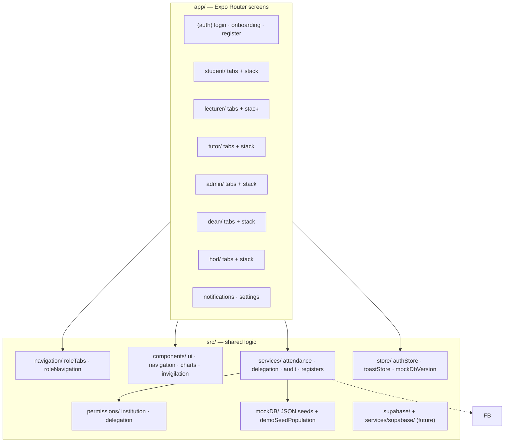

| Layer | Responsibility |
|--------|----------------|
| **`app/`** | Routes = files. Each role uses **tabs** for main areas and a **stack** for detail screens. |
| **`src/services/`** | Business rules: sessions, marks, delegations, PDF registers, audit filtering. |
| **`src/mockDB/`** | In-memory simulator until Supabase is wired. |
| **`src/navigation/`** | Tab definitions, quick-nav copy, tab bar metrics. |
| **`src/permissions/`** | Capability matrix and delegation checks. |

---

## 2. App bootstrap & authentication flow

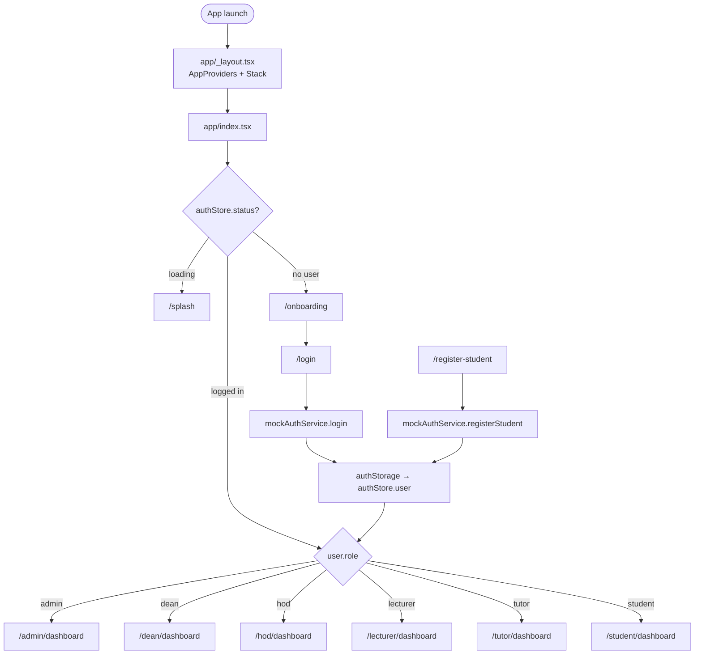

| Step | Files |
|------|--------|
| Providers wrap app | `src/providers/AppProviders.tsx`, `app/_layout.tsx` |
| Auth state | `src/store/authStore.ts`, `src/utils/authStorage.ts` |
| Login / register | `app/(auth)/login.tsx`, `register-student.tsx`, `src/services/mockAuthService.ts` |
| Demo accounts | `src/constants/demoLogins.ts` |
| Role guard on screens | `src/hooks/useRoleGuard.ts` |
| Sign out | `src/hooks/useLogout.ts`, `src/components/navigation/LogoutButton.tsx` |

---

## 3. Navigation pattern (tabs + stack)

Every institutional role uses the same shell: **bottom tabs** for main areas, **stack push** for workflows that need full screen (no tab bar).

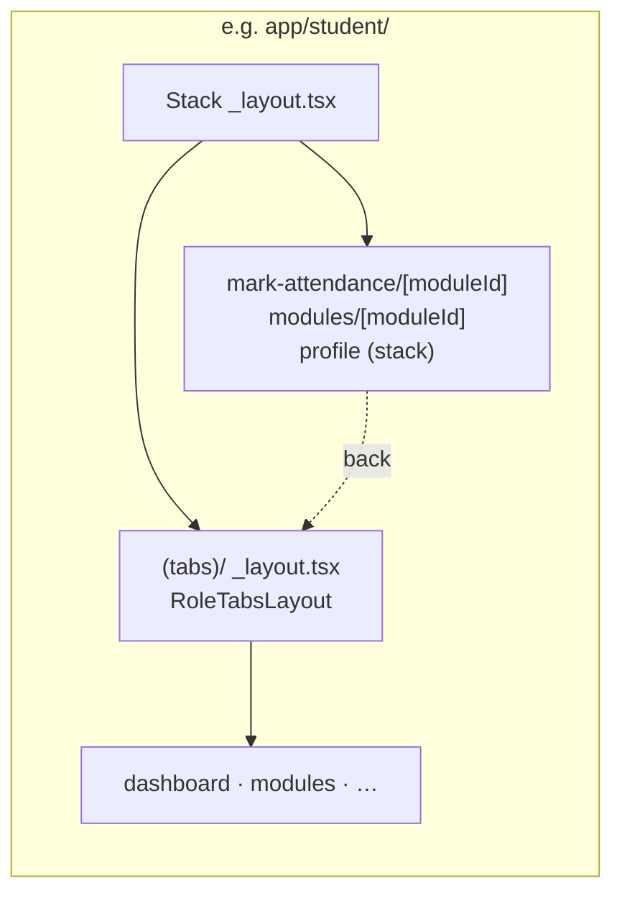

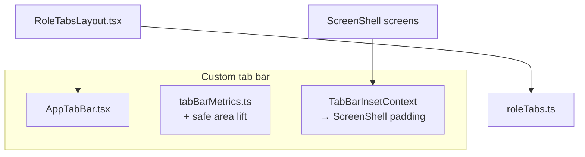

### Bottom tabs by role

| Role | Tab routes (`app/<role>/(tabs)/`) |
|------|-----------------------------------|
| **Student** | `dashboard` · `modules/index` · `join-class` · `attendance-history` · `profile` · `more` |
| **Lecturer** | `dashboard` · `module-management` · `analytics` · `audit-logs` · `more` |
| **Tutor** | `dashboard` · `sessions` · `registers` · `timesheets` · `more` |
| **Admin** | `dashboard` · `analytics` · `audit-logs` · `seed` · `more` |
| **Dean** | `dashboard` · `analytics` · `audit-logs` · `more` |
| **HOD** | `dashboard` · `analytics` · `audit-logs` · `more` |

Tab config: `src/navigation/roleTabs.ts` · Descriptions & quick links: `src/navigation/roleNavigation.ts` · More menu: `src/components/navigation/MoreMenuScreen.tsx`

---

## 4. Institutional hierarchy (data model)

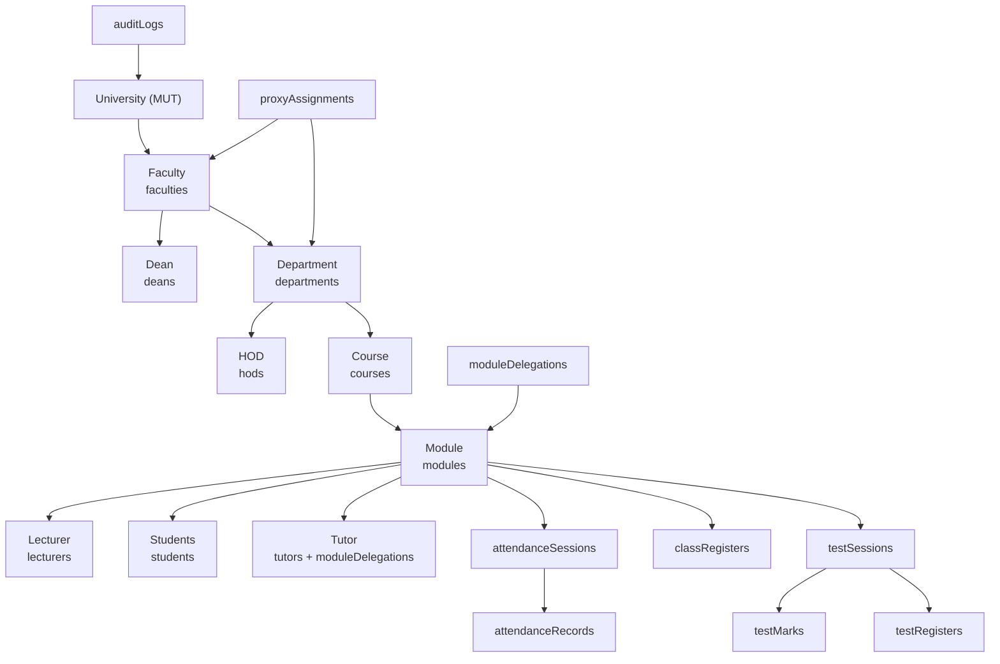

---

## 5. Student — class attendance flow

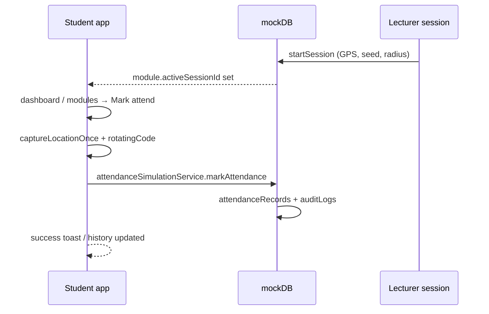

| Screen | Path | Service / util |
|--------|------|----------------|
| Home | `app/student/(tabs)/dashboard.tsx` | — |
| Module detail | `app/student/modules/[moduleId].tsx` | — |
| Mark attendance | `app/student/mark-attendance/[moduleId].tsx` | `attendanceSimulationService.ts` |
| History | `app/student/(tabs)/attendance-history.tsx` | `mockDB.attendanceRecords` |
| Join class | `app/student/(tabs)/join-class.tsx` | `moduleEnrollmentService.ts` |
| Rotating code | — | `src/utils/rotatingCode.ts` |
| GPS once | — | `src/utils/captureLocationOnce.ts`, `haversine.ts` |

---

## 6. Lecturer — class session & roster flow

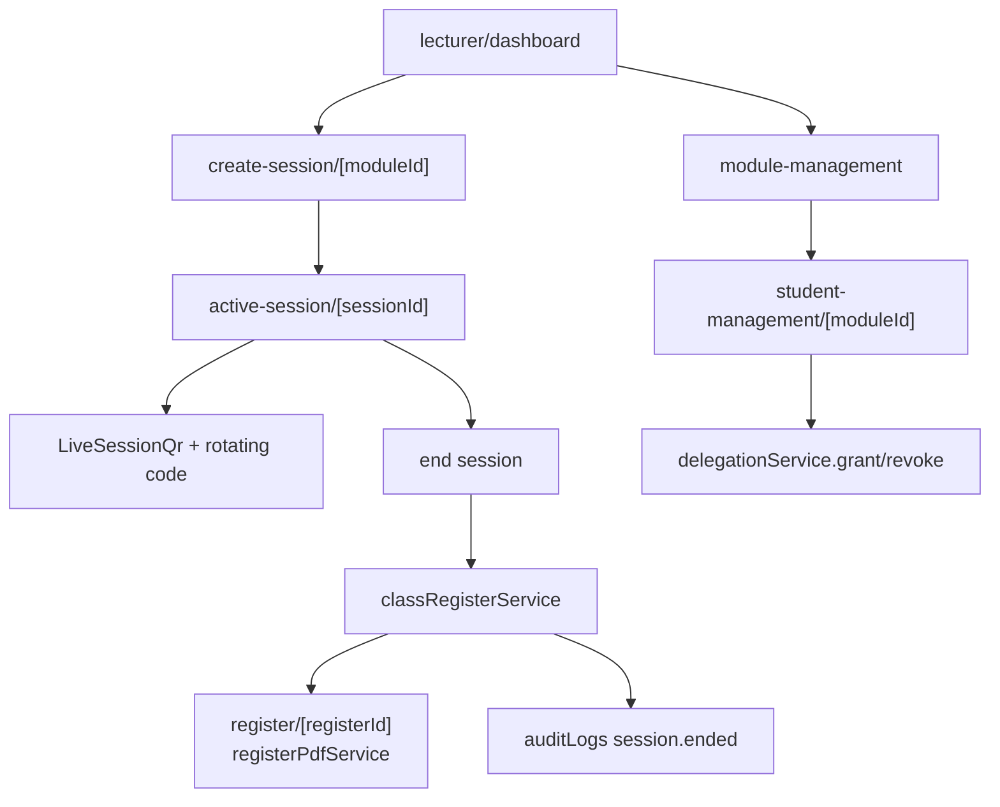

| Screen | Path |
|--------|------|
| Create session | `app/lecturer/create-session/[moduleId].tsx` |
| Live session | `app/lecturer/active-session/[sessionId].tsx` |
| Student roster | `app/lecturer/student-management/[moduleId].tsx` |
| PDF register | `app/lecturer/register/[registerId].tsx` |

---

## 7. Test invigilation flow (lecturer + tutor)

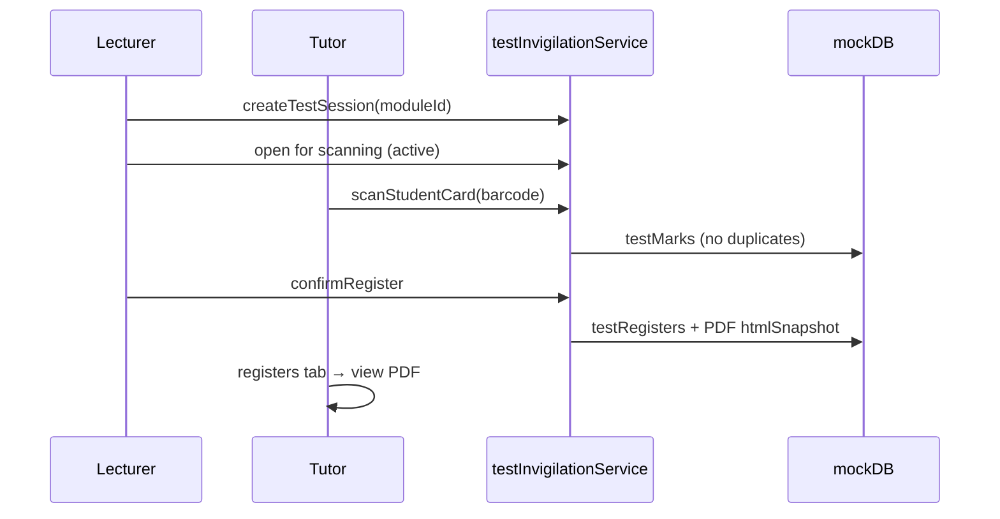

| Screen | Path |
|--------|------|
| Configure test | `app/lecturer/test-session/[moduleId].tsx` |
| Lecturer scan UI | `app/lecturer/test-invigilate/[testSessionId].tsx` |
| Tutor scan UI | `app/tutor/test-invigilate/[testSessionId].tsx` |
| Scanner component | `src/components/invigilation/StudentCardScanner.tsx` |
| Service | `src/services/testInvigilationService.ts` |

---

## 8. Tutor — delegation, sessions, payroll

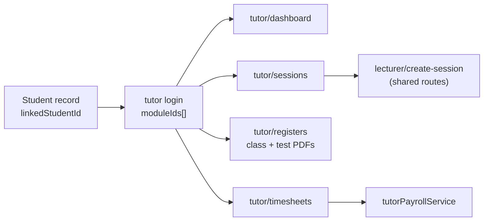

Tutors are **senior students** with `moduleDelegations` grants. They can start sessions on delegated modules; hours flow to `tutorTimesheets` after confirmed class/test work.

---

## 9. Governance — analytics & audit logs

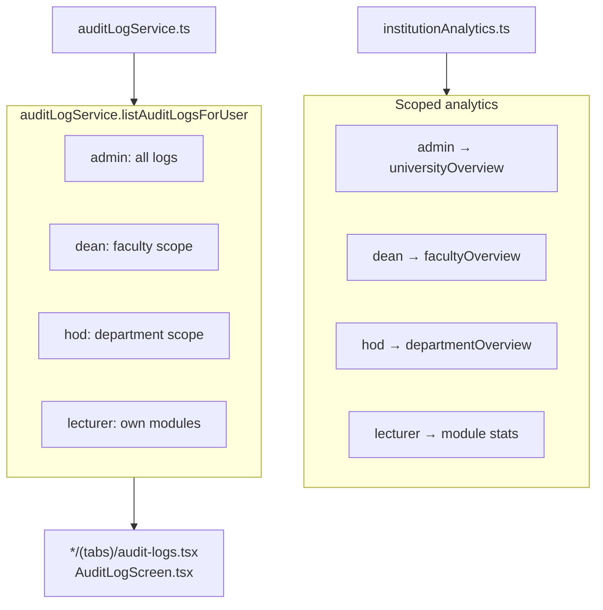

| Role | Audit tab | Dashboard service |
|------|-----------|-------------------|
| Admin | `app/admin/(tabs)/audit-logs.tsx` | `institutionAnalytics.universityOverview` |
| Dean | `app/dean/(tabs)/audit-logs.tsx` | `facultyOverview(facultyId)` |
| HOD | `app/hod/(tabs)/audit-logs.tsx` | `departmentOverview(departmentId)` |
| Lecturer | `app/lecturer/(tabs)/audit-logs.tsx` | Module-scoped logs only |

Delegation and proxy changes write to `auditLogs` via `delegationService.ts` and `attendanceSimulationService.ts`. Demo data: `src/mockDB/demoSeedPopulation.ts`.

---

## 10. Mock database lifecycle

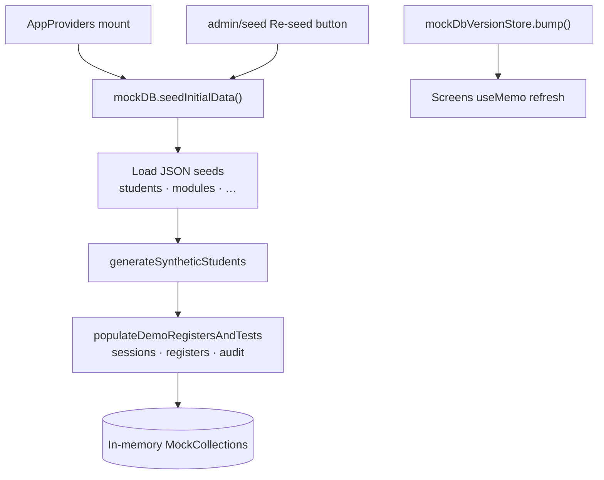

Entry point: `src/mockDB/mockDBService.ts` · Demo population: `src/mockDB/demoSeedPopulation.ts`

---

## 11. Screen representation diagrams

Wireframe-style maps of what the user sees. All authenticated screens use **`ScreenShell`** unless noted.

### 11.1 Universal screen chrome

**Tab screen** (bottom navigation visible):

```
┌──────────────────────────────────────────┐
│  Title                          [logout] │  ← Header (accent border)
│  Subtitle (optional)                     │
├──────────────────────────────────────────┤
│                                          │
│   Scrollable content                     │
│   ┌────────────────────────────────┐     │
│   │ AppCard · ModuleCard · charts  │     │
│   └────────────────────────────────┘     │
│   SectionHeader · ListPressableItem      │
│                                          │
├──────────────────────────────────────────┤
│  Innovation Lab footer (most screens)    │
├──────────────────────────────────────────┤
│  🏠   📚   ➕   🕐   👤   ☰              │  ← AppTabBar (lifted above
└──────────────────────────────────────────┘     system gesture area)
```

**Stack / detail screen** (pushed on top — **no tab bar**, back + logout in header):

```
┌──────────────────────────────────────────┐
│  ←   Title                      [logout] │
├──────────────────────────────────────────┤
│   Full-screen workflow (mark attend,     │
│   live session, PDF register, scanner)   │
└──────────────────────────────────────────┘
```

| Chrome piece | Component | Notes |
|--------------|-----------|--------|
| Header row | `Header.tsx` | `showBack` on stack screens; `LogoutButton` when signed in |
| Page body | `ScreenShell.tsx` | Scroll + `TabBarInsetContext` bottom padding on tabs |
| Tab bar | `AppTabBar.tsx` | Icons from `roleTabs.ts`; extra safe-area lift |
| Toasts | `ToastNotification.tsx` | Global via `toastStore` |

---

### 11.2 Auth & public screens

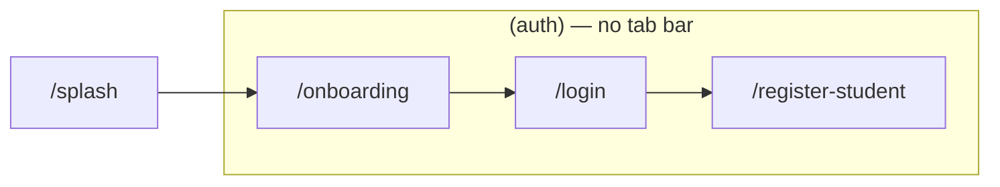

**Onboarding** (`/onboarding`)

```
┌──────────────────────────────────────────┐
│           STARS wordmark                 │
│     Welcome copy                         │
│  ┌────────────────────────────────────┐  │
│  │ AppButton  Get started → login     │  │
│  └────────────────────────────────────┘  │
│  LinkText  Register as student           │
│  Innovation Lab footer                   │
└──────────────────────────────────────────┘
```

**Login** (`/login`)

```
┌──────────────────────────────────────────┐
│           STARS wordmark                 │
│  ChipSelectGroup  role (6 roles)         │
│  AppInput  email                         │
│  AppInput  password                      │
│  AppButton  Sign in                      │
│  Chip row  demo quick-login presets      │
│  LinkText  Register · Back               │
└──────────────────────────────────────────┘
```

---

### 11.3 Student — screen map

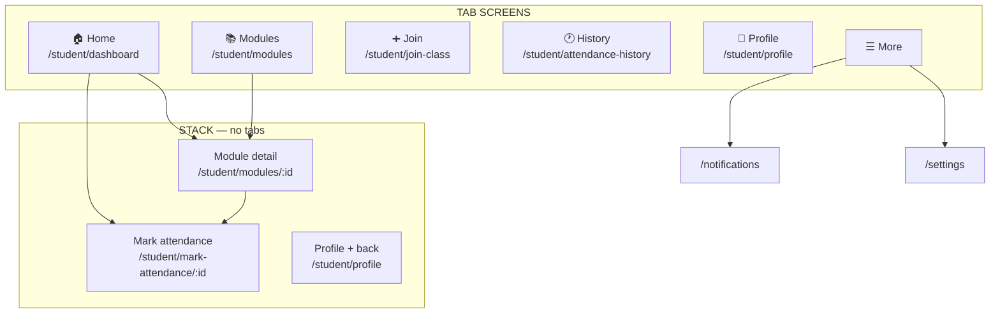

**Home** — custom header (no default `ScreenShell` title row)

```
┌──────────────────────────────────────────┐
│ STARS          Alerts    [logout] Avatar │
│ Hello, {firstName}                       │
│ Intro copy                               │
│ ── My classes ──                         │
│ ┌ ModuleCard  CODE · Name ────────────┐  │
│ │  meta · [Attend now] if live        │  │
│ └─────────────────────────────────────┘  │
│ ┌ Attendance % card ──────────────────┐  │
│ └─────────────────────────────────────┘  │
│ Quick navigation list                    │
│ [tab bar]                                │
└──────────────────────────────────────────┘
```

**Mark attendance** (stack)

```
┌──────────────────────────────────────────┐
│  ←  Mark attendance              [logout]│
│  SessionTimer · module name                │
│  [ Scan QR ] [ Enter code ]  tabs        │
│  ┌ camera or AppInput 6-digit code ───┐  │
│  └────────────────────────────────────┘  │
│  AppButton  Submit check-in              │
│  (GPS captured once on submit)           │
└──────────────────────────────────────────┘
```

---

### 11.4 Lecturer — screen map

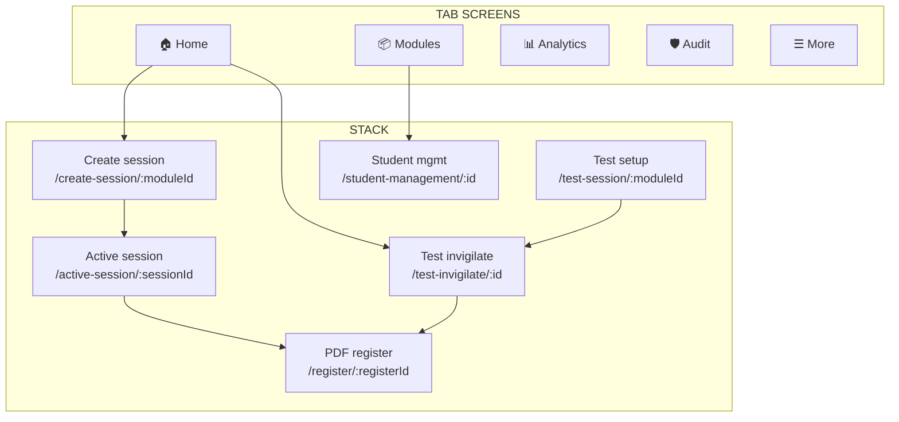

**Active session** (stack)

```
┌──────────────────────────────────────────┐
│  ←  Live session                 [logout]│
│  Module · SessionTimer                   │
│  ┌────────────────────────────────────┐  │
│  │   LiveSessionQr  (rotating)        │  │
│  │   6-digit code  · refresh countdown│  │
│  └────────────────────────────────────┘  │
│  Present count / enrolled                │
│  AppButton  End class → class register   │
└──────────────────────────────────────────┘
```

**Test invigilation** (stack — lecturer or tutor)

```
┌──────────────────────────────────────────┐
│  ←  {test title}                 [logout]│
│  TestInvigilatePanel                     │
│  ┌ StudentCardScanner ────────────────┐  │
│  │  camera · barcode                   │  │
│  └────────────────────────────────────┘  │
│  Scanned list · mark count               │
│  AppButton  Confirm register → PDF       │
└──────────────────────────────────────────┘
```

---

### 11.5 Tutor — screen map

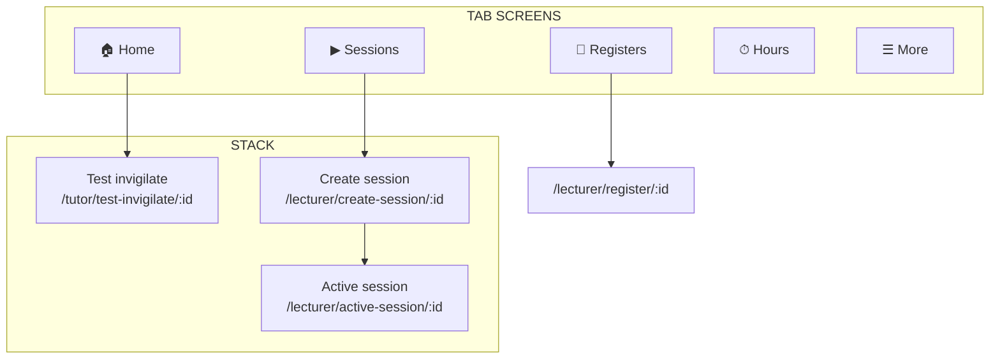

**Tutor home**

```
┌──────────────────────────────────────────┐
│  Tutor hub                       [logout]│
│  RoleScopeCard  name · year · hours      │
│  ── Test invigilation (if active) ──     │
│  ListPressableItem → test scan screen    │
│  ── Delegated modules ──                 │
│  ModuleCard + DelegationBadge            │
│  Chip  Open live session                 │
│  Quick navigation                        │
│ [tab bar]                                │
└──────────────────────────────────────────┘
```

---

### 11.6 Admin · Dean · HOD — screen maps

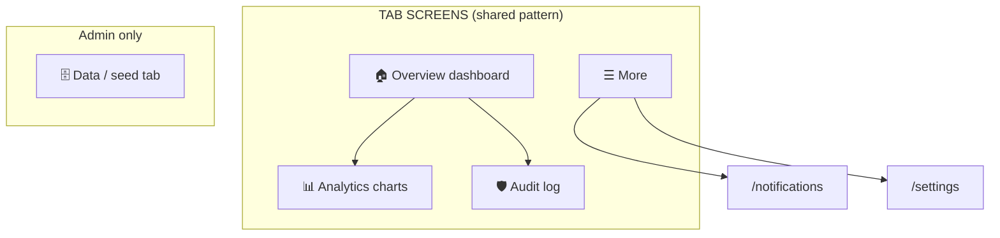

**Admin overview**

```
┌──────────────────────────────────────────┐
│  University overview             [logout]│
│  Intro paragraph                         │
│  StatTile grid  students · faculties …   │
│  AppCard  activity & alerts              │
│  AppCard  faculty performance rows       │
│  StatsBarChart · StatsLineChart          │
│  RoleQuickNav  audit · analytics · seed  │
│ [tab bar: Overview|Charts|Audit|Data|More]│
└──────────────────────────────────────────┘
```

**Dean / HOD overview** (same shell, scoped copy)

```
┌──────────────────────────────────────────┐
│  Faculty / Department overview   [logout]│
│  HighlightStat  attendance rate          │
│  AppCard  modules or departments list    │
│  StatsBarChart · StatsLineChart preview  │
│  AppButton  → full analytics tab         │
│  RoleQuickNav                            │
│ [tab bar]                                │
└──────────────────────────────────────────┘
```

**Audit log tab** (all four roles — scoped data)

```
┌──────────────────────────────────────────┐
│  {University|Faculty|Dept|Module} audit  │
│  Scope description card                  │
│  ┌ AppCard per event ─────────────────┐  │
│  │ action label · timestamp            │  │
│  │ Actor · Scope · Target rows         │  │
│  └────────────────────────────────────┘  │
│ [tab bar]                                │
└──────────────────────────────────────────┘
```

---

### 11.7 Shared screens

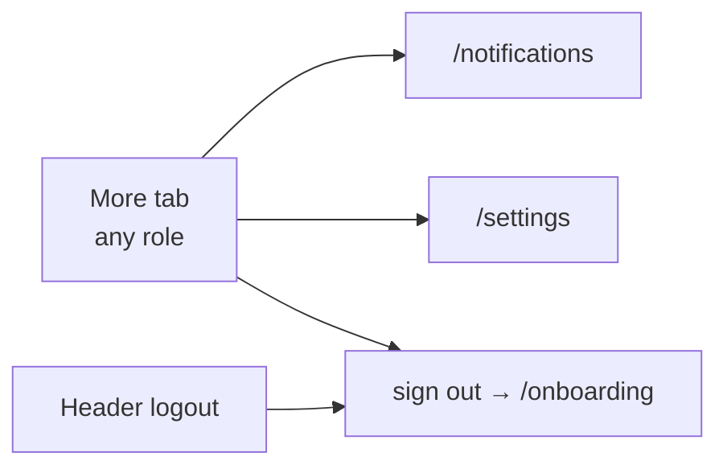

**More menu** (every role)

```
┌──────────────────────────────────────────┐
│  More                            [logout]│
│  AppCard  signed-in user + role          │
│  ── Your tabs ──  (hint per tab)       │
│  ── Tools & shortcuts ──                 │
│  ListPressableItem + description         │
│  Notifications · Settings              │
│  LogoutButton · SignOutLink              │
│ [tab bar]                                │
└──────────────────────────────────────────┘
```

**Notifications** / **Settings** (stack from More — `showBack`)

```
┌──────────────────────────────────────────┐
│  ←  Notifications                [logout]│
│  AppCard list of alert items             │
│  LinkText  Close                         │
└──────────────────────────────────────────┘
```

---

### 11.8 Full app screen index (by URL)

| URL | Type | Role(s) | Primary UI blocks |
|-----|------|---------|-------------------|
| `/splash` | Public | — | Loading indicator |
| `/onboarding` | Auth | — | Wordmark, CTA, register link |
| `/login` | Auth | — | Role picker, credentials, demo chips |
| `/register-student` | Auth | — | Enrolment form |
| `/student/dashboard` | Tab | Student | Module cards, attendance %, quick nav |
| `/student/modules` | Tab | Student | Module list |
| `/student/join-class` | Tab | Student | Class code input |
| `/student/attendance-history` | Tab | Student | Past marks list |
| `/student/profile` | Tab / stack | Student | Avatar, KeyValueRows |
| `/student/modules/:id` | Stack | Student | Module detail |
| `/student/mark-attendance/:id` | Stack | Student | QR / code, GPS submit |
| `/lecturer/dashboard` | Tab | Lecturer | Promo banners, module chips |
| `/lecturer/module-management` | Tab | Lecturer | Module list |
| `/lecturer/analytics` | Tab | Lecturer | Charts, at-risk |
| `/lecturer/audit-logs` | Tab | Lecturer | Audit cards |
| `/lecturer/create-session/:id` | Stack | Lecturer, Tutor | GPS, start session |
| `/lecturer/active-session/:id` | Stack | Lecturer, Tutor | QR, code, end class |
| `/lecturer/test-session/:id` | Stack | Lecturer | Create test |
| `/lecturer/test-invigilate/:id` | Stack | Lecturer, Tutor | Scanner panel |
| `/lecturer/student-management/:id` | Stack | Lecturer | Roster, delegation |
| `/lecturer/register/:id` | Stack | All* | HTML/PDF register view |
| `/tutor/dashboard` | Tab | Tutor | Delegations, live tests |
| `/tutor/sessions` | Tab | Tutor | Module session list |
| `/tutor/registers` | Tab | Tutor | Class + test PDF list |
| `/tutor/timesheets` | Tab | Tutor | Hours submission |
| `/admin/dashboard` | Tab | Admin | University KPIs |
| `/admin/analytics` | Tab | Admin | Full charts |
| `/admin/audit-logs` | Tab | Admin | All audit events |
| `/admin/seed` | Tab | Admin | Re-seed, demo links |
| `/dean/dashboard` | Tab | Dean | Faculty KPIs |
| `/dean/analytics` | Tab | Dean | Faculty charts |
| `/dean/audit-logs` | Tab | Dean | Faculty-scoped audit |
| `/hod/dashboard` | Tab | HOD | Department KPIs |
| `/hod/analytics` | Tab | HOD | Department charts |
| `/hod/audit-logs` | Tab | HOD | Department-scoped audit |
| `/notifications` | Shared | All | Alert cards |
| `/settings` | Shared | All | Privacy / appearance cards |

\*Register screen is shared; opened from lecturer/tutor/admin demo links.

---

### 11.9 Role × navigation matrix

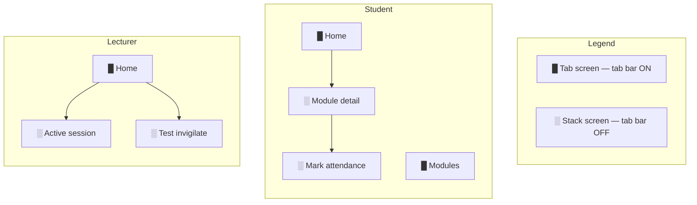

| Visual | Meaning |
|--------|---------|
| Tab screen | User stays in `(tabs)/`; bottom icons always visible |
| Stack screen | Slides in from right; `←` back returns to previous tab state |
| Shared route | Same component path under `/lecturer/…` may be used by tutor (e.g. sessions) |

---

## 12. File structure diagram

Route groups `(tabs)` and `(auth)` do **not** appear in the URL.

```
ATTANDANCE/
├── app/                              # Expo Router — screens & URLs
│   ├── _layout.tsx                   # Root: AppProviders, global Stack
│   ├── index.tsx                     # Auth redirect → role dashboard
│   ├── splash.tsx
│   ├── +html.tsx · +not-found.tsx
│   ├── notifications.tsx · settings.tsx
│   │
│   ├── (auth)/                       # /login, /onboarding, /register-student
│   │   ├── _layout.tsx
│   │   ├── login.tsx
│   │   ├── onboarding.tsx
│   │   └── register-student.tsx
│   │
│   ├── student/
│   │   ├── _layout.tsx               # Stack: tabs + detail screens
│   │   ├── (tabs)/
│   │   │   ├── _layout.tsx           # RoleTabsLayout("student")
│   │   │   ├── dashboard.tsx
│   │   │   ├── modules/index.tsx
│   │   │   ├── join-class.tsx
│   │   │   ├── attendance-history.tsx
│   │   │   ├── profile.tsx
│   │   │   └── more.tsx
│   │   ├── modules/[moduleId].tsx
│   │   ├── mark-attendance/[moduleId].tsx
│   │   └── profile.tsx               # Stack variant (showBack)
│   │
│   ├── lecturer/
│   │   ├── _layout.tsx
│   │   ├── (tabs)/
│   │   │   ├── dashboard · module-management · analytics
│   │   │   ├── audit-logs · more
│   │   ├── create-session/[moduleId].tsx
│   │   ├── active-session/[sessionId].tsx
│   │   ├── test-session/[moduleId].tsx
│   │   ├── test-invigilate/[testSessionId].tsx
│   │   ├── student-management/[moduleId].tsx
│   │   └── register/[registerId].tsx
│   │
│   ├── tutor/
│   │   ├── _layout.tsx
│   │   ├── (tabs)/
│   │   │   ├── dashboard · sessions · registers
│   │   │   ├── timesheets · more
│   │   └── test-invigilate/[testSessionId].tsx
│   │
│   ├── admin/
│   │   ├── _layout.tsx
│   │   └── (tabs)/
│   │       ├── dashboard · analytics · audit-logs
│   │       ├── seed · more
│   │
│   ├── dean/
│   │   ├── _layout.tsx
│   │   └── (tabs)/
│   │       ├── dashboard · analytics · audit-logs · more
│   │
│   └── hod/
│       ├── _layout.tsx
│       └── (tabs)/
│           ├── dashboard · analytics · audit-logs · more
│
├── src/
│   ├── navigation/
│   │   ├── roleTabs.ts               # Tab names & icons per role
│   │   ├── roleNavigation.ts         # Hub links, descriptions, More copy
│   │   └── tabBarMetrics.ts          # Tab bar height & safe-area lift
│   │
│   ├── contexts/
│   │   └── TabBarInsetContext.tsx    # Bottom padding for tab screens
│   │
│   ├── components/
│   │   ├── navigation/
│   │   │   ├── AppTabBar.tsx
│   │   │   ├── RoleTabsLayout.tsx
│   │   │   ├── MoreMenuScreen.tsx
│   │   │   ├── RoleQuickNav.tsx
│   │   │   ├── AuditLogScreen.tsx
│   │   │   └── LogoutButton.tsx
│   │   ├── ui/                       # AppButton, ScreenShell, ModuleCard, …
│   │   ├── charts/                   # StatsBarChart, StatsLineChart
│   │   ├── attendance/               # LiveSessionQr
│   │   └── invigilation/             # StudentCardScanner, TestInvigilatePanel
│   │
│   ├── screens/
│   │   └── StudentProfileContent.tsx
│   │
│   ├── services/
│   │   ├── mockAuthService.ts
│   │   ├── attendanceSimulationService.ts
│   │   ├── moduleEnrollmentService.ts
│   │   ├── delegationService.ts
│   │   ├── classRegisterService.ts
│   │   ├── testInvigilationService.ts
│   │   ├── registerPdfService.ts
│   │   ├── tutorPayrollService.ts
│   │   ├── auditLogService.ts
│   │   ├── institutionAnalytics.ts
│   │   ├── supabase/                 # Live Postgres repositories
│   │   └── offline/                  # PouchDB scaffold
│   │
│   ├── models/                       # TypeScript domain types
│   ├── types/                        # roles, capabilities, supabaseUserProfile
│   ├── permissions/
│   │   ├── institutionPermissions.ts
│   │   └── delegationPermissions.ts
│   │
│   ├── store/
│   │   ├── authStore.ts
│   │   ├── toastStore.ts
│   │   └── mockDbVersionStore.ts
│   │
│   ├── mockDB/
│   │   ├── mockDBService.ts
│   │   ├── demoSeedPopulation.ts
│   │   ├── syntheticPopulation.ts
│   │   └── *.json                    # Seed data
│   │
│   ├── supabase/                     # Client init, table names, mappers
│   ├── hooks/                        # useRoleGuard, useLogout
│   ├── utils/                        # rotatingCode, haversine, barcodes, PDF HTML
│   ├── theme/                        # colors, typography, radius
│   └── providers/AppProviders.tsx
│
├── assets/                           # App icon, splash
├── public/                           # Web static (index.html)
├── app.json
├── package.json
├── README.md
├── FILE_STRUCTURE.md                 # Beginner file lookup table
├── INSTITUTION_HIERARCHY.md          # Roles & org model
├── SUPABASE_INTEGRATION.md           # Migration jobs & Postgres plan
└── FLOW_AND_STRUCTURE.md             # This document
```

---

## 13. Service → screen map (quick reference)

| Service | Primary consumers |
|---------|-------------------|
| `mockAuthService` | `(auth)/login`, `register-student` |
| `attendanceSimulationService` | `create-session`, `active-session`, `mark-attendance` |
| `moduleEnrollmentService` | `join-class`, `student-management` |
| `delegationService` | `student-management`, tutor `sessions` |
| `classRegisterService` | `register/[registerId]`, tutor `registers` |
| `testInvigilationService` | `test-session`, `test-invigilate/*` |
| `registerPdfService` | PDF / print views |
| `tutorPayrollService` | tutor `timesheets` |
| `auditLogService` | `*/audit-logs` tabs |
| `institutionAnalytics` | admin / dean / hod dashboards & analytics |

---

## 14. Related documentation

| Document | Contents |
|----------|----------|
| [README.md](./README.md) | Quick start, scripts, demo logins |
| [FILE_STRUCTURE.md](./FILE_STRUCTURE.md) | “I need to change…” lookup table |
| [INSTITUTION_HIERARCHY.md](./INSTITUTION_HIERARCHY.md) | Roles, delegation, proxy, collections |
| [SUPABASE_INTEGRATION.md](./SUPABASE_INTEGRATION.md) | Postgres tables, RLS, job breakdown |
| [ADJUSTED_INSTITUTIONAL_HIERARCHY.md](./ADJUSTED_INSTITUTIONAL_HIERARCHY.md) | Hierarchy adjustments (if present) |

---

*Last updated to reflect tab navigation (`(tabs)/`), audit log tabs, tutor sessions tab, lifted bottom tab bar, and screen wireframe diagrams (§11).*
