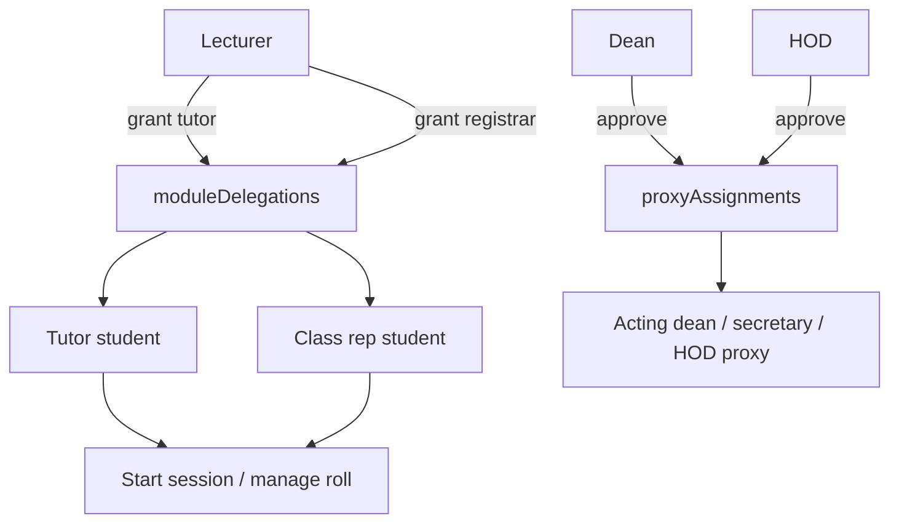

# STARS — Institutional hierarchy, roles & permissions

This document describes how **Mangosuthu University of Technology** is modelled inside STARS: structure, **six institutional roles**, **flexible delegation** (tutor, class registrar, acting dean/HOD proxy), scoped analytics, and navigation.

---

## Structural model

```
University (MUT — `src/models/University.ts`)
└── Faculty
    ├── Dean (+ optional Acting Dean / faculty secretary with dean-approved proxy)
    └── Departments
        ├── HOD (+ optional department proxy)
        ├── Courses (qualifications)
        │   ├── Lecturers
        │   ├── Students
        │   └── Modules
        └── Module
            ├── Lecturer (primary)
            ├── Tutor(s) — students with lecturer-granted privileges
            └── Students (enrolled)
```

**Collections (mock / Firestore):**

| Collection | Purpose |
|------------|---------|
| `faculties` | Top divisions; `deanId`, `secretaryId`, `actingDeanId` |
| `facultySecretaries` | Faculty operational staff |
| `departments` | Sub-units; `hodId`, `lecturerIds`, `courseIds` |
| `deans` | One dean per faculty |
| `hods` | One HOD per department |
| `courses` | Qualifications; `lecturerIds`, `studentIds`, `modules[]` |
| `modules` | Class offerings; `lecturerId`, `tutorIds`, enrolment |
| `tutors` | Student-linked tutor profiles |
| `moduleDelegations` | Lecturer grants (tutor / student registrar) |
| `proxyAssignments` | Dean/HOD/Admin acting-on-behalf grants |
| `auditLogs` | Privilege, proxy, session, attendance events |
| `userProfiles` | Firebase Auth UID → role + links + extra capabilities |

---

## Roles (high → scoped)

| Role | Scope | Primary routes |
|------|--------|----------------|
| **Admin** | Entire university | `/admin/dashboard`, `/admin/seed`, `/admin/analytics` |
| **Dean** | Single **faculty** | `/dean/dashboard`, `/dean/analytics` |
| **HOD** | Single **department** | `/hod/dashboard`, `/hod/analytics` |
| **Lecturer** | Assigned **modules** | `/lecturer/*` |
| **Tutor** | Delegated **modules** (also a student) | `/tutor/dashboard` |
| **Student** | Own enrolment & attendance | `/student/*` |

Constants: `src/types/roles.ts` · Capabilities: `src/types/capabilities.ts` · Matrix: `src/permissions/institutionPermissions.ts` · Module/proxy rules: `src/permissions/delegationPermissions.ts`

---

## Responsibilities by role

### Admin

- Add / edit / delete users (production: Firebase + admin tools)
- Access all stats and **audit logs** (`auditLogs`)
- Grant or revoke user privileges (`userProfiles.grantedCapabilities`)
- University-wide analytics and reports

### Dean

- View faculty analytics (faculty, departments, courses)
- View attendance for all courses and lectures in the faculty
- View department details (lecturers, students, courses)
- Designate a **proxy** on behalf of dean (`proxyAssignments`)
- Generate faculty reports
- Activate and deactivate proxy assignments

### HOD

- View attendance for all courses and lectures in their department
- Generate department reports
- Activate and deactivate **department proxy** privileges
- **Quality control** — flag modules/lecturers with persistently low attendance
- View lectures and modules in department
- Designate proxies within department scope

### Lecturer

- Monitor students with low attendance on assigned modules
- Manage attendance (start/end sessions)
- **Activate/deactivate tutor** privileges per module (`delegationService.grantModuleDelegation`)
- **Delegate class registrar** — student can start session / mark roll when class runs independently
- Generate module attendance reports
- Start and end class sessions
- Accept / reject join requests
- Add students to modules
- View modules, sessions, attendance records

### Tutor (also a student)

- **Always sourced from `students`** — senior student helping junior cohorts (see `yearLevel` on student/tutor)
- Run delegated class sessions; **confirm class ended** → PDF register lists all tutor names + attendance + duration
- **Paid by institution per hours** — `tutorTimesheets` after class/test; submit via `/tutor/timesheets`
- **Test invigilation** on any module (lecturer adds them) — scan student card barcode or manual number; shared register, no duplicate marks
- After lecturer confirms test over, **PDF register** appears for tutors at `/tutor/registers`
- Sign in with **Tutor** role pill (`22005678@live.mut.ac.za` demo)

### Student

- Check in (mark own attendance)
- Monitor own attendance
- Request to join a session / module
- View module history, session history, profile
- May receive **student_registrar** delegation for a specific module/day

---

## Flexible delegation flows



**Implementation**

| Concern | Path |
|---------|------|
| Grant/revoke module delegation | `src/services/delegationService.ts` |
| Can user start session? | `src/permissions/delegationPermissions.ts`, `src/utils/delegation.ts` |
| Session host audit | `AttendanceSessionModel.startedByRole`, `startedById` |
| UI badges | `src/components/ui/DelegationBadge.tsx` |

**Demo seed**

- Tutor: `22005678@live.mut.ac.za` → Mobile Development (`mod_mobile`)
- Registrar: `22001234@live.mut.ac.za` → Database Systems (`mod_db`)
- Acting dean proxy: HOD IT for Engineering faculty (`proxy_dean_eng_hod`)

**Class register PDF** — `classRegisterService.confirmClassEnded` → `expo-print` PDF with tutor name(s), students, date/time, duration.

**Test invigilation** — `testInvigilationService` · routes: `/lecturer/test-session/[moduleId]`, `/lecturer/test-invigilate/[id]`, `/tutor/test-invigilate/[id]`. Student cards use barcode `MUT:{studentNumber}` (`src/utils/studentCardBarcode.ts`).

---

## Analytics scoping

`src/services/institutionAnalytics.ts`

| Role | Method | Boundary |
|------|--------|----------|
| Admin | `universityOverview()` | All |
| Dean | `facultyOverview(facultyId)` | Faculty |
| HOD | `departmentOverview(departmentId)` | Department |
| Lecturer | `lecturerScoped(lecturerId)` | Assigned modules |
| Tutor | Module delegations | Delegated modules only |
| Student | `studentScoped(studentId)` | Self |

---

## Authentication (mock)

Password for all demo accounts: **`password`**

| Role | Example emails |
|------|----------------|
| Admin | `admin@mut.ac.za` |
| Dean | `dean.engineering@mut.ac.za`, `dean.management@mut.ac.za` |
| HOD | `hod.it@mut.ac.za`, `hod.electrical@mut.ac.za`, … |
| Lecturer | `mkhize@mut.ac.za`, `naidoo@mut.ac.za`, … |
| Tutor | `22005678@live.mut.ac.za` |
| Student | `*@live.mut.ac.za` (seed + synthetic) |

Presets: `src/constants/demoLogins.ts` · Login: `app/(auth)/login.tsx`

---

## Firebase alignment

- Collections: `src/firebase/collections.ts`
- Profile shape: `src/types/firebaseUserProfile.ts`
- Rules must enforce: base role + `moduleDelegations` + `proxyAssignments` + `auditLogs` (see `FIREBASE_INTEGRATION.md`)

---

## Related files

- Models: `ProxyAssignment`, `ModuleDelegation`, `Tutor`, `AuditLog`, `FacultySecretary`, updates to `Faculty`, `Course`, `Module`, `Attendance`
- Utils: `src/utils/delegation.ts`, `src/utils/roleRouting.ts`
- Tutor UI: `app/tutor/dashboard.tsx`
