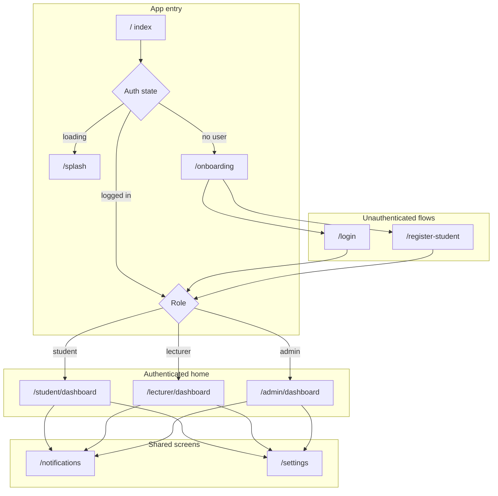
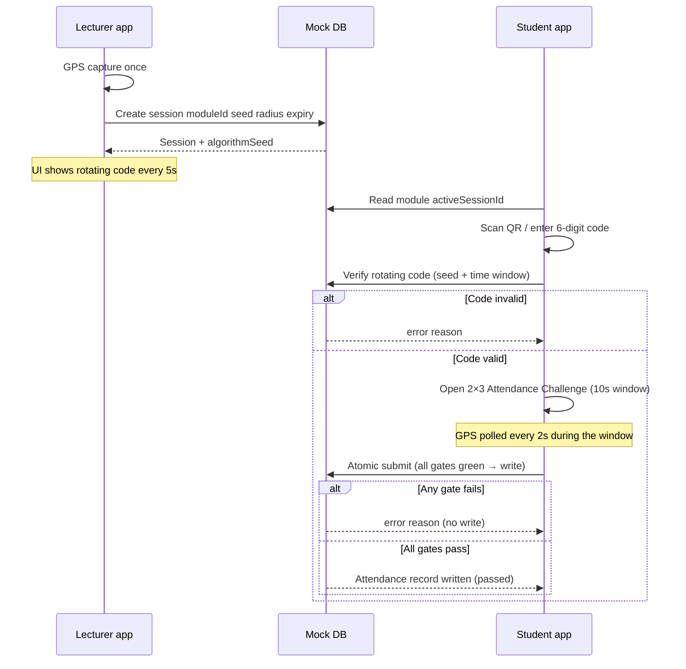
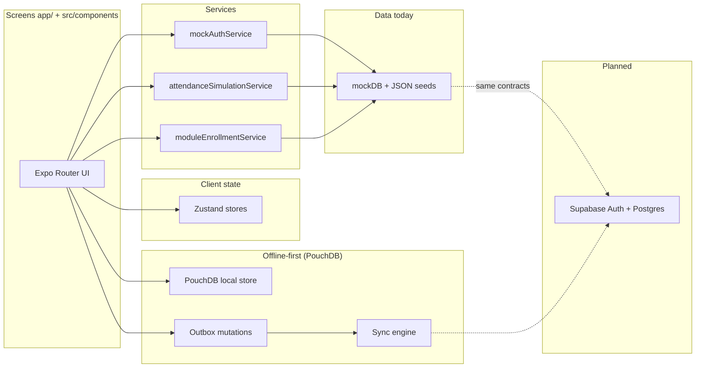

<div align="center">

# ⏱ STARS · PILOT COUNTDOWN ⏱

# 🔴 `17` WORKING DAYS TO PILOT

### 🎯 Module attendance goes **LIVE** — Friday, 10 July 2026

```
┌──────────┬──────────┬──────────┬──────────┐
│    17    │    08    │    00    │    SS     │
│   DAYS   │  HOURS   │   MIN    │   SEC     │
└──────────┴──────────┴──────────┴──────────┘
   18 JUN  ──────────────────────────►  10 JUL
```

`M1 Auth → M2 Profiles → M3 Reads → M4 ATTENDANCE → M5 / M6 Trust → 🚀`


&nbsp;

&nbsp;


**Mon–Fri only · ≈ 3.5 working weeks · the date is fixed, scope flexes**

▶ **[Open the LIVE ticking clock → `PILOT_COUNTDOWN.html`](./PILOT_COUNTDOWN.html)** &nbsp;·&nbsp; **[Full dated plan](./SUPABASE_INTEGRATION.md#pilot-sprint-plan--schedule-m1--pilot-10-jul-2026)**

</div>

---

# STARS

**STARS** — Smart attendance for **Mangosuthu University of Technology**, built with Expo, TypeScript, and Expo Router. The app ships with a **mock JSON / in-memory database** so flows work offline-first; Supabase can replace the same service boundaries later.

## Quick start

```bash
npm install
npx expo start -c
```

- **Web:** open the URL Expo prints (favicon: `public/favicon.svg` and `assets/favicon.svg`).
- **Node:** use **20.19+** for Expo SDK 54.

## Clone-and-run (no surprises)

- **Prereqs**: Node **20.19+** (see `.nvmrc`)
- **Clean reset** (when things get weird after upgrades):

```bash
rm -rf node_modules
rm -f package-lock.json
npm cache verify
npm install
npx expo start -c
```

- **Windows PowerShell reset**:

```powershell
Remove-Item -Recurse -Force node_modules
Remove-Item -Force package-lock.json
npm cache verify
npm install
npx expo start -c
```

## Installation & toolchain

| Tool | Version | Notes |
|------|---------|--------|
| **Node.js** | **20.19+** | Required by Expo SDK 54 — see `.nvmrc` |
| **npm** | 10+ (bundled with Node) | `npm install` at repo root |
| **Expo SDK** | **54** | `package.json` → `expo ~54.0.0` |
| **TypeScript** | **5.9** | `devDependencies` |
| **@supabase/supabase-js** | **2.106+** | Client present; app stays on **mock** until M1 |
| **Supabase CLI** (optional) | 2.x | `supabase db push` — install: `npm i -g supabase` |

### Local environment & Env Setup (STORY-002)

1. Copy **[.env.example](./.env.example)** → **`.env`** (never commit `.env`).
2. Paste **Project URL** and **anon key** from the Supabase dashboard (shared securely by JOB-001 owner).
3. Use **`EXPO_PUBLIC_DATA_SOURCE=mock`** until your integrated flows work; set to **`supabase`** to test against Postgres (see [integration workboards](./SUPABASE_INTEGRATION.md#developer-integration-workboards)).

See **[SUPABASE_INTEGRATION.md](./SUPABASE_INTEGRATION.md#m0--integration-sprint-start-here)** (M0 section at the top) for per-developer integration tasks: Supabase, wire services, remove mock/dummy data on existing screens.

### Version changelog

| Date | Change | Notes |
| :--- | :--- | :--- |
| **2026-09-07** | Supabase integration verified live | All six roles authenticate against the live DB; added `get_faculty_overview` RPC; new **lecturer analytics**; UI depth pass. See **[TEAM_TEST_REPORT.md](./TEAM_TEST_REPORT.md)** |
| **2026-05-21** | Integration sprint + workboards | M0 in **SUPABASE_INTEGRATION.md**; `dataSource.ts`; `challenge-object-library.json` |
| **2026-05-21** | Expo SDK 54 | React 19.1, React Native 0.81.5 — see `package.json` |

When you upgrade Expo, Node, or Supabase CLI, add a row here and note any clean-reset steps from **Clone-and-run** below.

## Documentation

See **[DOCUMENTATION.md](./DOCUMENTATION.md)** for the full **tech stack**, **engineering process**, routing notes, and attendance simulation overview.

## Integration Sprint (M0)

The M0 integration sprint introduces Supabase into STARS while preserving existing service boundaries.

### Developer workboards

- See [SUPABASE_INTEGRATION.md](./SUPABASE_INTEGRATION.md#m0--integration-sprint-start-here)
- Follow the assigned developer workboards for:
  - Supabase setup
  - Service wiring
  - Removal of mock data
  - Attendance integration
  - Authentication integration

### Environment setup

Before testing Supabase integration:

1. Copy `.env.example` to `.env`
2. Configure:
   - `EXPO_PUBLIC_SUPABASE_URL`
   - `EXPO_PUBLIC_SUPABASE_ANON_KEY`
   - `EXPO_PUBLIC_DATA_SOURCE`
3. Set `EXPO_PUBLIC_DATA_SOURCE=supabase` to run against the live backend, or `mock` for the offline JSON store. **The Supabase path is now verified end-to-end** — all six roles (student, tutor, lecturer, dean, HOD, admin) authenticate and load live data. Every service keeps a mock fallback, so the app still runs with `mock`.

For detailed setup instructions, see:
- [SUPABASE_INTEGRATION.md](./SUPABASE_INTEGRATION.md#m0--integration-sprint-start-here)

**QA & status:** see **[TEAM_TEST_REPORT.md](./TEAM_TEST_REPORT.md)** (issue → resolution, JOB/STORY status marks, QA test stories) and **[ISSUES_AND_FIXES.md](./ISSUES_AND_FIXES.md)** (detailed fix log).


See **[FILE_STRUCTURE.md](./FILE_STRUCTURE.md)** for a **beginner-friendly map** of every important file and **which file to open for which kind of work**.

See **[SUPABASE_INTEGRATION.md](./SUPABASE_INTEGRATION.md#m0--integration-sprint-start-here)** for **M0 integration sprint** (first section): Supabase + wire services + remove dummy data on existing screens.

See **[SUPABASE_INTEGRATION.md](./SUPABASE_INTEGRATION.md)** for **milestones (M0–M6)**, **JOB register**, and later app wiring (**Brightman**, **Gugulethu**, **Basil**).

See **[DATABASE_SCHEMA.md](./DATABASE_SCHEMA.md)** for **ER diagrams**, **table columns**, and **relationship connections**.

See **[ATTENDANCE_SECURITY_ARCHITECTURE.md](./ATTENDANCE_SECURITY_ARCHITECTURE.md)** for the **authoritative attendance security design + implementation plan** (rotating code, mandatory geofencing, one-time tokens, server-side validation RPC, RLS, offline, threats, testing).

See **[full-challenge-mechanism.md](./full-challenge-mechanism.md)** for the original attendance **challenge gates**, tiers, and `attendance_records` fields (superseded by the architecture doc above).

See **[INSTITUTION_HIERARCHY.md](./INSTITUTION_HIERARCHY.md)** for **faculty → department → course** structure, **Admin / Dean / HOD / Lecturer / Student** roles, and **scoped analytics**.

## Analytics

Analytics are **role-scoped** and live in `src/services/institutionAnalytics.ts` (aggregates) and `src/services/analyticsRepository.ts` (trend/heatmap views). Every method has a **live Supabase path with a mock fallback**, so screens work in both `mock` and `supabase` modes.

| Role | Screen | Metrics | Live source |
|------|--------|---------|-------------|
| **Admin** | `/admin` Overview + Charts | Students, lecturers, faculties, departments, courses, overall attendance %, active sessions, faculty performance | `get_university_overview()` RPC |
| **Dean** | `/dean` Faculty overview + Charts | Faculty attendance index, per-department attendance + student counts, lecturer performance, low-performing departments | `useDeanData` hook + `get_faculty_overview()` RPC |
| **HOD** | `/hod` Department overview + Charts | Department attendance rate, at-risk students, module performance, risk trends, heatmap | `get_department_overview()` RPC + `module_performance` view |
| **Lecturer** | `/lecturer` Analytics | Overall attendance, live sessions, marks, **per-module participation** (bar chart + breakdown), top / needs-attention module | `institutionAnalytics.lecturerAnalytics()` over `modules` / `attendance_sessions` / `attendance_records` |

**Participation** = average share of enrolled students marked present per session, clamped to `[0,1]`. The analytics RPCs live in `supabase/migrations/` (e.g. `get_faculty_overview` in `20260907090000_analytics_overview_functions.sql`); deploy with `supabase db push`.

## Web document head & SEO

- **Default Metro web:** the HTML shell is **`public/index.html`** (title, meta, OG/Twitter, favicon link). Expo injects the JS bundle there.
- **Static / server web output:** root document can come from **`app/+html.tsx`** when `expo.web.output` is `static` or `server` — keep both in sync if you change branding or SEO.
- Copy **[.env.example](./.env.example)** to `.env` and set **`EXPO_PUBLIC_SITE_URL`** when you deploy (for `og:url` / canonical in `+html.tsx` builds).

## Brand

- Product name: **STARS** (`StarsWordmark` component).
- Footer: **Created by the MUT Innovation Lab** (`InnovationLabFooter`).

---

## Project flow (diagrams)

### 1. Application entry, auth, and role routing

High-level navigation from cold start to role-specific areas. Route groups such as `(auth)` organize files only; URLs are shown as users see them.



### 2. Attendance session lifecycle (mock simulation)

How a live class check works end-to-end using the in-memory store, **one-shot GPS** on both sides, and a **time-based rotating 6-digit code** (no per-tick server writes).



### 3. Data & service layers (conceptual)



---

## Engineering best practices (project rules)

- **Single source of truth**: screens (`app/`) do not talk to databases directly. They call services in `src/services/`.
- **No code duplication**: if logic repeats across two screens/services, extract it into `src/services/`, `src/utils/`, or `src/components/ui/` once.
- **No component duplication**: create one shared component and parametrize it instead of copying a screen card/button/chart.
- **Offline-first writes**: any user action that creates/updates data should be able to run offline by **enqueueing a mutation**; sync runs in the background.


---

## Functional requirements

Requirements reflect **current mock behaviour**; production hardening (real auth, RLS policies, audit logs) is assumed for a Supabase cutover.

### Authentication & session

| ID | Requirement |
|----|----------------|
| **FR-A1** | The system shall support three roles: **student**, **lecturer**, and **admin**, with route guards so each role only reaches allowed screens. |
| **FR-A2** | Unauthenticated users shall be directed through **onboarding**, **login**, or **register-student** before accessing role dashboards. |
| **FR-A3** | **Students** may self-register with profile fields (name, student number, gender, faculty, course) and receive a generated **@live.mut.ac.za**-style email; mock passwords follow documented demo rules. |
| **FR-A4** | **Lecturers** shall authenticate with email present in seed data; **admin** shall use the fixed demo admin account (see `mockAuthService`). |
| **FR-A5** | Session persistence shall use **SecureStore** on native and **localStorage** on web via a single **authStorage** abstraction. |

### Student

| ID | Requirement |
|----|----------------|
| **FR-S1** | Students shall view a **dashboard** listing registered modules and navigation to module detail, attendance, profile, and history. |
| **FR-S2** | Students shall **join a class** using a module **class code** (enrollment updates module and student records). |
| **FR-S3** | Students may **request enrollment** on a module; lecturers can accept or reject **pending** requests. |
| **FR-S4** | When a module has an **active attendance session**, students shall **mark attendance** with **one GPS capture** and the **current rotating code** shown by the lecturer. |
| **FR-S5** | Attendance submission shall fail with a clear reason if: session missing/expired, code invalid, student too far outside **radius**, not enrolled, or **duplicate** mark for the session. |
| **FR-S6** | Students shall access **attendance history** and **profile** consistent with mock data. |

### Lecturer

| ID | Requirement |
|----|----------------|
| **FR-L1** | Lecturers shall use a **dashboard** hub for modules, sessions, analytics, and management flows. |
| **FR-L2** | Lecturers shall **create an attendance session** for an owned module with **one GPS capture**, default **radius** and **duration**, and server-side session metadata including **algorithmSeed**. |
| **FR-L3** | During an active session, the UI shall display a **rotating 6-digit code** (and matching QR) derived from seed and time window (~5s). |
| **FR-L4** | Lecturers shall **manage modules** (view/control flows wired to mock DB). |
| **FR-L5** | Lecturers shall **manage students** on a module: view enrollment, **accept/reject** pending joins. |
| **FR-L6** | Lecturers shall open an **active session** screen for monitoring/timing and access **analytics** views backed by mock data. |

### Admin

| ID | Requirement |
|----|----------------|
| **FR-M1** | Admins shall use **`/admin/dashboard`** for university analytics and **`/admin/seed`** for simulation controls (not under a visible `(admin)` URL segment). |
| **FR-M2** | Admins shall see **collection counts** for faculties, courses, modules, lecturers, students, sessions, and records. |
| **FR-M3** | Admins shall **re-seed** the mock database to restore demo state. |

### Cross-cutting

| ID | Requirement |
|----|----------------|
| **FR-X1** | The app shall provide **notifications** and **settings** routes shared across roles. |
| **FR-X2** | The data layer shall mimic **collection-style** entities (`mockDB`) so services can be swapped for **Supabase** without rewriting navigation. |
| **FR-X3** | UI shall follow STARS **design tokens** (e.g. `#E8E8E8`, `#006281`, `#4F1A1D`) and reuse **ScreenShell**, **InnovationLabFooter**, and **StarsWordmark** for consistency. |

---

## Legacy bootstrap note

If you scaffold from zero with `create-expo-app`, align dependencies with `package.json` in this repo, then copy `app/` and `src/` as needed.
