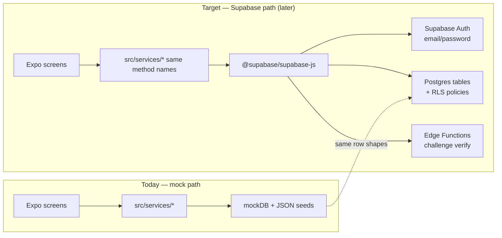
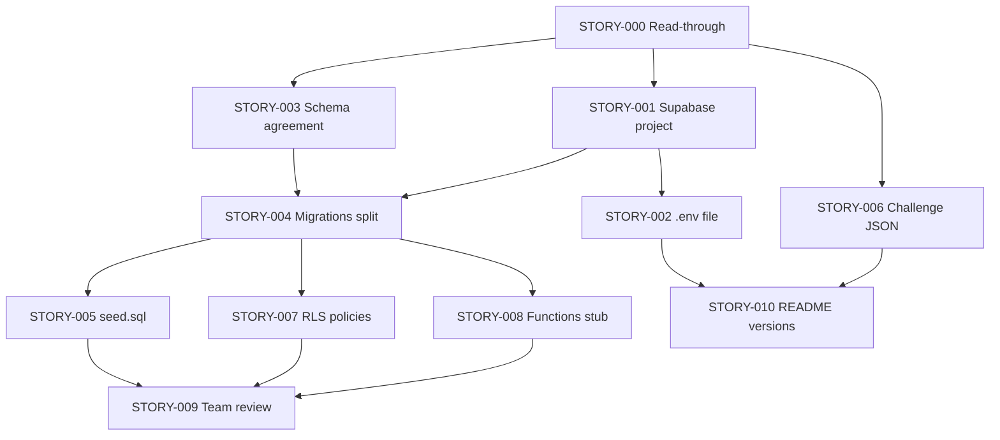

# STARS — Supabase (Auth + Postgres) integration

**Audience:** Brightman, Gugulethu, Basil — and anyone new to the codebase.

This document ties **milestones**, **user stories**, and **file ownership** together. **Start with [M0 — Foundation sprint](#m0--foundation-sprint-start-here)** (step-by-step stories for first-time Supabase work). Later sections cover M1–M6 app wiring.


## M0 — Foundation sprint (start here)

**Audience:** Brightman, Gugulethu, Basil — first-time Supabase contributors.

**Scope of this sprint:** Set up the **Supabase project**, **Postgres schema**, **RLS policies**, **seed data**, **challenge parameter JSON**, and a **local `.env` file**. You will **not** wire the Expo app to Supabase yet (no `JOB-006` login, no `EXPO_PUBLIC_DATA_SOURCE=supabase` in daily dev). The app keeps using **mock JSON** until M1.

**Read first (whole team, ~30 min):**

| Doc | Why |
|-----|-----|
| [DATABASE_SCHEMA.md](./DATABASE_SCHEMA.md) | Tables, columns, FKs, ER diagrams |
| Sections below (M1–M6) | JOB register and app wiring |
| [full-challenge-mechanism.md](./full-challenge-mechanism.md) | Challenge gates + `attendance_records` shape |

---

## How Supabase fits STARS (learn this before coding)

STARS today stores everything in **`src/mockDB/`** (JSON + in-memory). That lets the UI work offline with no cloud account. For production, the **same shapes** move to **Supabase**:



| Supabase piece | STARS use | You build in M0 |
|----------------|-----------|-----------------|
| **Auth** | Student/lecturer/admin login; `user_profiles.id` = `auth.users.id` | Enable email provider in dashboard only |
| **Postgres** | Faculties, modules, sessions, `attendance_records`, etc. | SQL migrations in `supabase/migrations/` |
| **RLS** | Students only see their rows; lecturers see their modules | Policies in `*_rls.sql` + `supabase/policies.md` |
| **Edge Functions** | Recompute challenge seed; reject forged `tapped_index` | Stub folder + README (full logic in M6) |
| **Storage** (later) | Class register PDFs | Out of M0 scope |

**Important:** Screens never import SQL. They call **`src/services/`** → repositories → Supabase client. M0 only prepares the **database contract** so M1+ can swap mock internals without rewriting `app/`.

---

## Git workflow — avoid merge conflicts

### Branch naming

```
feature/JOB-00X-short-description
```

One branch per story. One **primary owner** per story. Open PR early (draft) so others see file locks.

### File ownership (do not edit another lane’s files in the same sprint)

| Lane | Owner | Touch only |
|------|-------|------------|
| **A — Platform** | Brightman | `supabase/migrations/0001_*.sql` (project notes), `0004_attendance*.sql`, `supabase/functions/`, `supabase/README.md` |
| **B — Connectivity** | Gugulethu | `.env.example`, `README.md` (env subsection, STORY-002), `src/data/challenge-object-library.json`, `0002_institution*.sql` |
| **C — Governance** | Basil | `DATABASE_SCHEMA.md` (sign-off comments), `supabase/policies.md`, `0003_people*.sql`, `0005_rls*.sql`, `supabase/seed.sql` |

**Shared read-only:** `src/supabase/tables.ts`, `src/models/*`, `src/mockDB/*.json` — propose changes in PR comments; only **JOB-003** owner merges `tables.ts` if names change.

### Merge order (rebase onto `main` in this sequence)

1. `JOB-003` schema agreement (no SQL yet — doc only)
2. `JOB-001` + `JOB-002` (project + env example)
3. Migrations `0002` → `0003` → `0004` (institution → people → attendance)
4. `JOB-005` seed + challenge JSON
5. `JOB-023` RLS (policies after tables exist)

### PR checklist (every story)

- [ ] PR title: `[JOB-00X] Short title`
- [ ] Only files in your **lane** changed (or team-agreed doc)
- [ ] `npm run` / Expo still works on **`mock`** (no requirement to set `.env`)
- [ ] No secrets in git (no `.env`, no service role key)
- [ ] Linked story section in PR description

---

## Tooling you will install (document versions in README)

| Tool | Min version | Used for |
|------|-------------|----------|
| **Node.js** | 20.19+ (see `.nvmrc`) | Expo app |
| **npm** | 10+ | `npm install` |
| **Git** | 2.40+ | branches, PRs |
| **Supabase account** | — | [supabase.com](https://supabase.com) dashboard |
| **Supabase CLI** (optional) | 2.x | `supabase db push`, local linking |

```bash
# Optional — Supabase CLI (install once per machine)
npm install -g supabase@latest
supabase --version
```

Record the CLI version you used in your PR when you run migrations.

---

### Foundation user stories (detailed)

---

## STORY-000 — Team read-through: Supabase’s role (no code)

**Maps to:** prerequisite for all JOBs  
**Owner:** Whole team  
**Estimate:** 30–45 minutes  

### Learning objectives

- Explain what **Auth**, **Postgres**, **RLS**, and **Edge Functions** each do in STARS.
- Point to where mock data lives today vs where live data will live.
- Describe why **`user_profiles.id`** must equal **`auth.users.id`**.

### Tasks

1. Read [How Supabase fits STARS](#how-supabase-fits-stars-learn-this-before-coding) above.
2. Open `src/mockDB/modules.json` and `DATABASE_SCHEMA.md` §5.4 `modules` — notice camelCase in JSON vs snake_case in SQL.
3. Open `src/supabase/tables.ts` — this is the **naming contract** for Postgres.
4. Skim `full-challenge-mechanism.md` §7 — list which columns land in `attendance_records`.
5. In stand-up, each person states one sentence: *“Supabase will replace ___ for my role.”*

### Acceptance criteria

- [ ] All three developers can answer: *Where does attendance data live today? Where will it live?*
- [ ] Team agrees: **M0 = database + docs only**, app stays on mock.

### Files

None (discussion only).

---

## STORY-001 — Create Supabase project (Auth + Postgres)

**Maps to:** **JOB-001**  
**Owner:** Brightman  
**Estimate:** 1–2 hours  

### Learning objectives

- Create a Supabase **organization** and **project**.
- Enable **Email** auth provider.
- Find **API URL**, **anon key**, and understand **service role** (never commit).

### Prerequisites

- STORY-000 complete.
- Supabase account.

### Step-by-step tasks

1. Go to [Supabase Dashboard](https://supabase.com/dashboard) → **New project**.
   - Name: `stars-mut-dev` (or team convention).
   - Region: closest to South Africa if available.
   - **Database password:** generate strong password → store in team password manager (not in git).
2. Wait for project provisioning (~2 min).
3. **Authentication → Providers → Email:** enable Email sign-in; disable magic link if team wants password-only for M1.
4. **Project Settings → API:** copy:
   - `Project URL` → will become `EXPO_PUBLIC_SUPABASE_URL`
   - `anon` `public` key → will become `EXPO_PUBLIC_SUPABASE_ANON_KEY`
5. **Do not** paste keys into the repo. Share via secure channel (1Password, Bitwarden, WhatsApp to leads only).
6. Add `supabase/README.md` section **“Project refs”** with:
   - Project name, region, ref id
   - “Keys live in password manager entry STARS-DEV”
   - Optional: second staging project name (empty if not created)

### What is a Postgres **table**? (mini-lesson)

A table is like one JSON file (`students.json`) but with enforced columns and types. Example:

```sql
create table students (
  id text primary key,
  full_name text not null,
  student_number text unique not null
);
```

You will create many tables in STORY-004; the dashboard **Table Editor** can preview them after migrations run.

### Acceptance criteria

- [ ] Dev project exists and is reachable in dashboard.
- [ ] Email auth provider enabled.
- [ ] API URL + anon key documented in team vault (not in git).
- [ ] `supabase/README.md` updated with project metadata (no secrets).

### Files you may touch

- `supabase/README.md` only

### Do not

- Commit `.env` or service role key.
- Change `src/supabase/client.ts` or any `app/` screen.

---

## STORY-002 — Local `.env` file + `.env.example` (no app connection test)

**Maps to:** **JOB-002** (env half only — **skip** `tryGetSupabaseClient()` verification until M1)  
**Owner:** Gugulethu  
**Estimate:** 45 minutes  

### Learning objectives

- Know why `.env` is gitignored and `.env.example` is tracked.
- Set Expo **public** env vars (safe for client bundle; RLS protects data).
- Understand difference between **mock** dev and **supabase** dev (later).

### Prerequisites

- STORY-001 keys available from Brightman (secure channel).

### Step-by-step tasks

1. Confirm `.gitignore` contains `.env` (already in repo).
2. Copy example file:

   ```bash
   cp .env.example .env
   ```

3. Edit **your local** `.env` only:

   ```env
   EXPO_PUBLIC_SUPABASE_URL=https://YOUR_PROJECT_REF.supabase.co
   EXPO_PUBLIC_SUPABASE_ANON_KEY=eyJhbGciOiJIUzI1NiIsInR5cCI6IkpXVCJ9...
   EXPO_PUBLIC_DATA_SOURCE=mock
   ```

   Keep `EXPO_PUBLIC_DATA_SOURCE=mock` for the whole foundation sprint.

4. Update `.env.example` with commented placeholders and short comments (no real keys):

   ```env
   # Supabase — get from Dashboard → Settings → API (JOB-001 owner shares securely)
   # EXPO_PUBLIC_SUPABASE_URL=https://xxxx.supabase.co
   # EXPO_PUBLIC_SUPABASE_ANON_KEY=

   # Stay on mock until M1 wiring (JOB-006+)
   EXPO_PUBLIC_DATA_SOURCE=mock
   ```

5. Add a **“Local environment”** subsection to [README.md](./README.md) (see STORY-010) pointing here.

6. **Optional check (do not fix app if it fails):** run `npx expo start` — app must still work with mock because no screen calls Supabase yet.

### Acceptance criteria

- [ ] `.env.example` updated and committed.
- [ ] Each developer has their own `.env` locally (not committed).
- [ ] README documents copy step and `EXPO_PUBLIC_DATA_SOURCE=mock` default.
- [ ] No changes to login screens or `authRepository` in this story.

### Files you may touch

- `.env.example`
- `README.md` (env subsection only — or coordinate with STORY-010)

### Do not

- Set `EXPO_PUBLIC_DATA_SOURCE=supabase`.
- Wire `app/(auth)/login.tsx` to Supabase.

---

## STORY-003 — Schema agreement (contract before SQL)

**Maps to:** **JOB-003**  
**Owner:** Basil  
**Estimate:** 2–3 hours  

### Learning objectives

- Map **`TABLES`** keys → Postgres snake_case names.
- Map **`src/models/*`** fields → SQL columns (see DATABASE_SCHEMA §5).
- Agree **text** vs **uuid** for primary keys (recommend **text** to keep `stu_*`, `mod_*` demo ids).

### Prerequisites

- STORY-000 complete.

### Step-by-step tasks

1. Open `src/supabase/tables.ts` — export is the authoritative **table name** list.
2. For each table in `TABLES`, open matching `src/models/*.ts` and `DATABASE_SCHEMA.md` §5 — fill checklist:

   | `TABLES` key | Postgres name | Model file | § in DATABASE_SCHEMA | Status |
   |--------------|---------------|------------|----------------------|--------|
   | `faculties` | `faculties` | `Faculty.ts` | 5.1 | ☐ |
   | … | … | … | … | ☐ |

3. For **`attendance_records`**, confirm challenge columns from `full-challenge-mechanism.md`:
   - `device_id`, `time_bucket`, `gps_bucket_hash`, `tapped_index`, `tier_used`, `action_hash`, `passed`
   - Unique constraint `(session_id, device_id)`
4. Add a short **“Schema agreement”** footer to `DATABASE_SCHEMA.md`:

   ```markdown
   ## Schema agreement sign-off
   - Date: YYYY-MM-DD
   - IDs: text PK (demo ids preserved)
   - Enrolment: jsonb arrays on modules/students (M0); junction tables optional later
   - Signed: Brightman / Gugulethu / Basil
   ```

5. If a name must change, update **`tables.ts`** in this PR only (one PR, team review).

### Acceptance criteria

- [ ] Every `TABLES` entry has a model + DATABASE_SCHEMA section.
- [ ] Challenge columns documented on `attendance_records`.
- [ ] Sign-off footer in `DATABASE_SCHEMA.md`.
- [ ] No migration SQL required in this story (docs only).

### Files you may touch

- `DATABASE_SCHEMA.md`
- `src/supabase/tables.ts` (only if team agrees a rename)

### Do not

- Create migrations yet (STORY-004).

---

## STORY-004 — Postgres tables via versioned migrations (split by lane)

**Maps to:** **JOB-004**  
**Owners:** Gugulethu + Basil + Brightman (parallel, merge in order)  
**Estimate:** 3–4 hours each lane  

### Learning objectives

- Write **`CREATE TABLE`** with PKs, FKs, `timestamptz`, `jsonb`.
- Use **numbered migration files** applied in order.
- Enable **RLS** on tables (`alter table … enable row level security`) even before policies exist.

### What is a **migration**?

A migration is a SQL file in git that changes the database schema. Everyone applies the same files so dev and prod stay aligned.

```
supabase/migrations/
  0002_institution_core.sql      ← Gugulethu
  0003_people_and_profiles.sql   ← Basil
  0004_attendance_challenge.sql  ← Brightman
```

`0001` is reserved for extensions + `user_profiles` if needed; otherwise start at `0002`.

### Lane B — Gugulethu: `0002_institution_core.sql`

Create tables (minimum columns from DATABASE_SCHEMA §5.1–5.3):

- `faculties`, `departments`, `courses`, `modules`

Include:

- `created_at timestamptz default now()`
- `jsonb` for denormalised id lists (`department_ids`, `enrolled_students`, etc.)
- Foreign keys: `departments.faculty_id` → `faculties.id`, etc.

End each table with:

```sql
alter table faculties enable row level security;
-- repeat for each table created
```

### Lane C — Basil: `0003_people_and_profiles.sql`

Tables:

- `students`, `lecturers`, `deans`, `hods`, `faculty_secretaries`, `tutors`
- `user_profiles` (PK `uuid` → will reference `auth.users` when users exist)
- `module_delegations`, `proxy_assignments`

`user_profiles` starter:

```sql
create table if not exists user_profiles (
  id uuid primary key references auth.users(id) on delete cascade,
  role text not null check (role in ('admin','dean','hod','lecturer','tutor','student')),
  email text not null,
  linked_person_id text,
  faculty_id text,
  department_id text,
  course_id text,
  linked_student_id text,
  granted_capabilities jsonb default '[]'::jsonb,
  active_proxy_ids jsonb default '[]'::jsonb,
  delegated_module_ids jsonb default '[]'::jsonb,
  updated_at timestamptz default now()
);
```

### Lane A — Brightman: `0004_attendance_challenge.sql`

Tables:

- `attendance_sessions`, `attendance_records`, `class_registers`
- `audit_logs`, `test_sessions`, `test_marks`, `test_registers`, `tutor_timesheets`

**`attendance_records`** must include challenge columns:

```sql
create table attendance_records (
  id text primary key,
  session_id text not null references attendance_sessions(id) on delete cascade,
  student_id text not null references students(id),
  timestamp timestamptz not null default now(),
  distance numeric,
  verified boolean default false,
  device_id text not null,
  time_bucket integer not null,
  gps_bucket_hash text not null,
  tapped_index smallint not null check (tapped_index between 0 and 5),
  tier_used smallint not null check (tier_used between 1 and 5),
  action_hash text not null,
  passed boolean not null default false,
  unique (session_id, device_id)
);
```

### Apply migrations (each owner after merge to `main`)

**Option A — Dashboard:** SQL Editor → paste one file → Run.  
**Option B — CLI:** `supabase db push` from repo root (after `supabase link`).

### Acceptance criteria

- [ ] Three migration files exist, numbered in merge order.
- [ ] All `TABLES` from `tables.ts` have a `CREATE TABLE` (split across the three files).
- [ ] RLS **enabled** on every table (policies come in STORY-007).
- [ ] `attendance_records` has unique `(session_id, device_id)`.
- [ ] `supabase/README.md` lists apply steps.

### Do not

- Edit another lane’s migration file.
- Wire the Expo app.

---

## STORY-005 — Seed data from mock JSON → SQL

**Maps to:** **JOB-005**  
**Owner:** Basil  
**Estimate:** 3–4 hours  
**Depends on:** STORY-004 merged and applied  

### Learning objectives

- Transform **`src/mockDB/*.json`** into `INSERT` statements.
- Keep **stable ids** (`stu_22001234`, `mod_mobile`) so docs and demos match.
- Document demo logins alignment with future Auth users.

### Step-by-step tasks

1. Create `supabase/seed.sql`.
2. For each seed JSON (`faculties.json`, `departments.json`, … `modules.json`, `students.json`, `lecturers.json`):
   - Convert keys: `moduleCode` → `module_code`, etc. (match `src/supabase/mappers/idBasedMapper.ts` conventions).
   - Use `insert into … values (…) on conflict (id) do nothing;` for idempotency.
3. Add **attendance** demo rows only if they include challenge fields or are clearly legacy (`verified` only) — prefer extending `attendanceRecords.json` in a follow-up PR with challenge fields documented.
4. Add **“Demo logins (M1)”** comment block referencing `src/constants/demoLogins.ts` — actual Auth users created in JOB-006, not M0.
5. Document run order in `supabase/README.md`: migrations first, then `seed.sql`.

### Acceptance criteria

- [ ] `supabase/seed.sql` loads without FK errors on empty DB after migrations.
- [ ] Re-running seed is documented (truncate vs `on conflict`).
- [ ] Table counts roughly match mock JSON counts.

### Files you may touch

- `supabase/seed.sql`
- `supabase/README.md`

### Do not

- Modify `src/mockDB/*.json` unless fixing typos (coordinate — high conflict risk).

---

## STORY-006 — Challenge object parameter library (JSON)

**Maps to:** new foundation deliverable (feeds UI + future Edge verify)  
**Owner:** Gugulethu  
**Estimate:** 2–3 hours  

### Learning objectives

- Understand the **960-object pool** (shape × color × size × pattern) from `full-challenge-mechanism.md` §3.
- Store **parameters**, not images — matches `AttendanceChallengeGrid` rendering.
- Align enums with `src/services/attendanceChallengeService.ts`.

### Why JSON if Postgres stores no challenge objects?

Supabase stores only the **outcome** (`tapped_index`, `tier_used`, `action_hash`, …). The **visual library** stays in the app as data so:

- All clients render the same object vocabulary.
- QA can diff JSON when enums change.
- Future Edge Function can import the same tier rules (M6).

### Step-by-step tasks

1. Create / maintain `src/data/challenge-object-library.json` with structure:

   ```json
   {
     "version": 1,
     "enums": {
       "shapes": ["circle", "square", "..."],
       "colors": ["red", "blue", "..."],
       "sizes": ["small", "medium", "large"],
       "patterns": ["solid", "outline", "striped", "dotted", "half"]
     },
     "pool": {
       "size": 960,
       "generation": "index maps to shape/color/size/pattern per attendanceChallengeService.objFromIndex"
     },
     "tiers": {
       "1": { "label": "Universal", "actions": ["tap_n", "hold_screen", "..."] },
       "2": { "label": "Touch enhanced", "actions": ["swipe_through", "..."] },
       "3": { "label": "Motion", "actions": ["shake_to_select", "..."] }
     },
     "seedFormula": {
       "inputs": ["session_id", "device_id", "gps_bucket_hash", "time_bucket"],
       "targetIndex": "seed mod 6",
       "poolOffset": "(seed >> 8) mod 960"
     }
   }
   ```

2. Add `src/data/README.md` explaining how seed + pool offset pick the six on-screen objects (link to `full-challenge-mechanism.md`).
3. Cross-check enums against `attendanceChallengeService.ts` — they must match exactly.
4. Optional: add `scripts/validate-challenge-library.mjs` that asserts array lengths (8×8×3×5 = 960).

### Acceptance criteria

- [ ] `challenge-object-library.json` committed with `version` field.
- [ ] Enums match TypeScript types in `attendanceChallengeService.ts`.
- [ ] `src/data/README.md` explains relationship to DB (`attendance_records` has no object blobs).
- [ ] No app import wiring required in M0 (JSON is documentation + future import).

### Files you may touch

- `src/data/challenge-object-library.json`
- `src/data/README.md`
- `scripts/validate-challenge-library.mjs` (optional)

### Do not

- Store student PII or session secrets in this JSON.

---

## STORY-007 — Row Level Security (RLS) policies

**Maps to:** **JOB-023** (foundation slice — core tables only)  
**Owner:** Basil  
**Estimate:** 3–4 hours  
**Depends on:** STORY-004 applied  

### Learning objectives

- Know what **RLS** does: Postgres filters rows per authenticated user.
- Write `CREATE POLICY` for **select** / **insert** / **update**.
- Document policy matrix for the team.

### Mini-lesson: RLS vs app guards

| Layer | Stops |
|-------|--------|
| `useRoleGuard` in app | Wrong **screens** — UX only, can be bypassed |
| **RLS** in Postgres | Wrong **data** — enforced even if someone crafts API calls |

### Step-by-step tasks

1. Create `supabase/policies.md` matrix:

   | Table | student | lecturer | admin |
   |-------|---------|----------|-------|
   | `students` | read self | read module enrollees | all |
   | `modules` | read enrolled | read taught | all |
   | `attendance_records` | insert/select own | read module session | all |
   | … | … | … | … |

2. Create `supabase/migrations/0005_rls_policies_v1.sql`:

   - Helper function example:

     ```sql
     create or replace function public.current_profile_role()
     returns text language sql stable security definer set search_path = public as $$
       select role from user_profiles where id = auth.uid()
     $$;
     ```

   - Policies using `auth.uid()` and `linked_person_id` patterns from DATABASE_SCHEMA §6.

3. **Foundation scope:** policies can use `auth.role() = 'authenticated'` placeholders where profile joins are not ready — document TODO for M2.

4. Run SQL as **authenticated test user** in dashboard (or document manual test steps).

### Acceptance criteria

- [ ] `policies.md` lists all core tables.
- [ ] Migration `0005_*` applies after `0004_*`.
- [ ] Anonymous users cannot read `students` / `attendance_records` (verify in API docs or dashboard).

### Files you may touch

- `supabase/policies.md`
- `supabase/migrations/0005_rls_policies_v1.sql`

### Do not

- Change Brightman’s `0004_attendance_challenge.sql` in the same PR (merge conflict).

---

## STORY-008 — Database functions + Edge Function stub (learn “functions”)

**Maps to:** prep for **JOB-032** (M6)  
**Owner:** Brightman  
**Estimate:** 2 hours  
**Depends on:** STORY-004  

### Learning objectives

- **Postgres function** — runs inside the database (e.g. scope helper).
- **Edge Function** — Deno/TypeScript at Supabase edge; verifies challenge on insert.

### Step-by-step tasks

1. If not in STORY-007, ensure `current_profile_role()` exists (SQL function).
2. Create folder `supabase/functions/verify-attendance-record/index.ts` with **stub**:

   - Read insert payload fields.
   - Comment blocks for steps 1–7 from `full-challenge-mechanism.md` § “Server-side verification”.
   - Return `{ passed: false, reason: 'NOT_IMPLEMENTED' }` until M6.

3. Add `supabase/functions/README.md`:

   - Deploy command: `supabase functions deploy verify-attendance-record`
   - “Not wired to app in M0”

4. Optional SQL function `attendance_records_device_free(session_id, device_id)` returning boolean for RLS checks.

### Acceptance criteria

- [ ] Stub Edge Function compiles (no deploy required for M0 if CLI not installed — document).
- [ ] README explains difference SQL function vs Edge Function.
- [ ] No app calls `functions.invoke` yet.

### Files you may touch

- `supabase/functions/**`
- `supabase/migrations/` only for SQL helper if agreed with Basil

---

## STORY-009 — Sync check: team integration review (no new features)

**Maps to:** M0 gate before M1  
**Owner:** Whole team  
**Estimate:** 1 hour  

### Tasks

1. Brightman confirms dashboard shows all tables.
2. Gugulethu confirms `.env.example` + local `.env` + challenge JSON present.
3. Basil confirms seed runs + `policies.md` complete.
4. Walk through merge order — any conflicts on `main`?
5. Update `SUPABASE_INTEGRATION.md` M0 checklist (optional one line each).

### Acceptance criteria

- [ ] All migrations applied on shared dev project.
- [ ] App still runs with mock only.
- [ ] Ready to schedule **JOB-006** (login wiring) in next sprint.

---

## STORY-010 — README: installations & version changelog

**Maps to:** documentation requirement  
**Owner:** Gugulethu (PR) + reviewers Basil & Brightman  
**Estimate:** 1 hour  

### Tasks

1. Add **Installation & toolchain** table to `README.md` (Node, Expo SDK, Supabase CLI).
2. Add **Version changelog** subsection — record repo versions when toolchain changes:

   | Date | Change | Notes |
   |------|--------|-------|
   | 2026-05-21 | Foundation stories added | M0 sprint |
   | … | Expo SDK 54 | `package.json` |

3. Link **M0 foundation sprint:** [SUPABASE_INTEGRATION.md](./SUPABASE_INTEGRATION.md#m0--foundation-sprint-start-here).
4. Link env setup to STORY-002.

### Acceptance criteria

- [ ] README has install table + changelog + links to schema/integration/challenge docs.
- [ ] `npm install` / `npx expo start -c` steps unchanged and tested.

### Files

- `README.md`

---

## Story dependency graph



---

## JOB number cross-reference

| Story | JOB |
|-------|-----|
| STORY-001 | JOB-001 |
| STORY-002 | JOB-002 (env only; defer client test) |
| STORY-003 | JOB-003 |
| STORY-004 | JOB-004 |
| STORY-005 | JOB-005 |
| STORY-006 | (new) Challenge JSON library |
| STORY-007 | JOB-023 (foundation slice) |
| STORY-008 | JOB-032 (stub) |
| STORY-009 | M0 gate |
| STORY-010 | README docs |

**Deferred to M1+ (not in this sprint):** JOB-006 through JOB-034 app wiring, except stubs noted above.

---

## What “done” looks like for M0

- [ ] Supabase dev project live (STORY-001)
- [ ] `.env.example` + per-dev `.env` documented (STORY-002)
- [ ] Schema signed off in DATABASE_SCHEMA.md (STORY-003)
- [ ] Migrations `0002`–`0005` applied (STORY-004, STORY-007)
- [ ] `seed.sql` loads demo institution data (STORY-005)
- [ ] `challenge-object-library.json` + README (STORY-006)
- [ ] Edge function stub + SQL helpers documented (STORY-008)
- [ ] README install/version section (STORY-010)
- [ ] **Expo app still uses mock** — no Supabase login in production path yet

---

1. **Read the tree once** — know the difference between **`src/supabase/`** (SDK wiring + mappers), **`src/services/supabase/`** (one table or concern per file), **`src/pipelines/`** (multi-step flows), and **`src/utils/supabase/`** (helpers).
2. **Pick a milestone** in order (M0 → M1 → …). Do not skip M0: without env and Supabase project setup, nothing else is verifiable.
3. **Claim user stories by job number** (`JOB-xxx`) in stand-up — one **primary owner** per job.
4. **Approach a story** using this loop:
   - **Reproduce** the behaviour today (mock path) vs desired (live path).
   - **Locate** the files in the tables below.
   - **Define “done”** using acceptance criteria; add a minimal test plan (device + web if relevant).
   - **Integrate** behind `EXPO_PUBLIC_DATA_SOURCE` until screens are switched safely.

---

## Already scaffolded in the repo

| Area | Path | What exists |
|------|------|-------------|
| Supabase client | `src/supabase/client.ts` | `tryGetSupabaseClient`, `requireSupabaseClient` |
| Table names | `src/supabase/tables.ts` | `TABLES`, `resolveTableName` |
| Row mappers | `src/supabase/mappers/` | `toRow`, `fromRow` (camelCase ↔ snake_case) |
| Generic read | `src/supabase/queries.ts` | `getRowById` |
| Auth API | `src/services/supabase/authRepository.ts` | Sign-in, sign-out, auth state subscription |
| Read-by-id repos | `src/services/supabase/*Repository.ts` | `get*ById` for main entities + `getUserProfileByUid` |
| Offline push sync | `src/services/offline/offlineSync.ts` | PouchDB outbox → Supabase upsert/update/delete |
| Challenge (mock UI) | `src/services/attendanceChallengeService.ts`, `app/student/challenge/` | Visual game + gates; **not** wired to Supabase yet |

**Your team builds:**

| Area | Path | You add |
|------|------|---------|
| Pipelines | `src/pipelines/` | Auth → profile → store; session writes; challenge submit |
| Helpers | `src/utils/supabase/` | Error mapping, retries, batch utilities |
| SQL + RLS | `supabase/migrations/` | Schema, policies, Edge Functions |

Domain **models** stay in `src/models/`. Profile: `src/types/supabaseUserProfile.ts`. Delegation: `src/services/delegationService.ts`, `src/permissions/delegationPermissions.ts`. Challenge spec: **`full-challenge-mechanism.md`**.

---

## Milestone map

| ID | Name | Goal |
|----|------|------|
| **M0** | Foundation | Supabase project, env, schema agreement, seed strategy |
| **M1** | Authentication | Email/password Auth from the app; session observable |
| **M2** | Profiles & roles | `user_profiles` maps Auth UID → STARS role + institutional links |
| **M3** | Read paths | Dashboards/lists/analytics read from Postgres (scoped by role) |
| **M4** | Write paths | Sessions, challenge attendance, enrolment, registers + RLS |
| **M5** | Cutover & hardening | `mock` \| `supabase` flag, migration, observability, parity |
| **M6** | Challenge backend | Edge verification, uniqueness, zero failed-row writes |

---

## Team roles (who does what)

| Team member | Purpose on this project | System responsibility |
|-------------|-------------------------|------------------------|
| **Brightman** | Platform & write-path owner | Supabase project, session creation, challenge record writes, production cutover |
| **Gugulethu** | Connectivity & data-path owner | Env, auth lifecycle, profiles, student reads, offline sync, data-source flag |
| **Basil** | Trust & governance owner | Schema contract, auth UX errors, RLS, lecturer reads, observability |

Everyone reviews everyone’s PRs; each job still has **one primary owner**.

---

## Job number register (all user stories)

Use **JOB-xxx** in commits, PR titles, and stand-up.

| Job # | Owner | Milestone | Title | Purpose in STARS |
|-------|-------|-----------|--------|------------------|
| **JOB-001** | Brightman | M0 | Supabase project (Auth + Postgres + Expo web app) | Live home for all STARS data and identities |
| **JOB-002** | Gugulethu | M0 | Local `.env` + `tryGetSupabaseClient()` verified | Every developer build reaches the same backend |
| **JOB-003** | Basil | M0 | Schema agreement (`TABLES` ↔ SQL ↔ models) | Contract between screens, TypeScript, and Postgres |
| **JOB-004** | Gugulethu | M0 | Initial migrations in `supabase/migrations/` | Versioned schema; reproducible deploys |
| **JOB-005** | Basil | M0 | Seed / bootstrap strategy (SQL or script) | Demo users + faculties/modules without mock JSON only |
| **JOB-006** | Brightman | M1 | Wire login to Supabase Auth (dev path) | Real identity before any profile logic |
| **JOB-007** | Gugulethu | M1 | Auth state subscription + hydration pattern | Session correct across restarts and navigation |
| **JOB-008** | Basil | M1 | Map Auth errors to user-facing copy | Students/lecturers understand login failures |
| **JOB-009** | Gugulethu | M2 | `user_profiles` CRUD repository (read + upsert) | UID → role + `linkedPersonId` + scope ids |
| **JOB-010** | Brightman | M2 | Registration pipeline (Auth + profile + person row) | New students exist consistently in Auth + Postgres |
| **JOB-011** | Basil | M2 | `useRoleGuard` + store use live profile when Supabase on | No cross-role URL access with live data |
| **JOB-012** | Gugulethu | M3 | Student dashboard modules query | Student home from enrolled modules in cloud |
| **JOB-013** | Basil | M3 | Lecturer modules list query | Lecturer hub from owned/co-taught modules |
| **JOB-014** | Gugulethu | M3 | Student attendance history query | History screen from `attendance_records` |
| **JOB-015** | Brightman | M3 | Active session read (student + lecturer) | `active_session_id` + session row for live UI |
| **JOB-016** | Gugulethu | M3 | Leadership analytics reads (admin / dean / HOD) | Replace mock aggregates with scoped SQL/views |
| **JOB-017** | Brightman | M3 | Attendance trend / time-bucket rollups | Chart series from Postgres, not dummy slopes |
| **JOB-018** | Basil | M3 | Audit log list query (scoped) | Governance screens mirror future RLS filters |
| **JOB-019** | Brightman | M4 | Persist “create attendance session” | Live sessions: GPS anchor, seed, radius, expiry |
| **JOB-020** | Gugulethu | M4 | Module `active_session_id` update on start/end | Single active session truth per module |
| **JOB-021** | Brightman | M4 | Challenge attendance submit → `attendance_records` | Only passed submissions written (see challenge doc) |
| **JOB-022** | Gugulethu | M4 | Offline outbox → Supabase for session/record writes | Offline-first parity with mock mutation pattern |
| **JOB-023** | Basil | M4 | RLS policies v1 (students, lecturers, roles) | Server-side gatekeeper for tamper prevention |
| **JOB-024** | Gugulethu | M4 | Enrolment writes (join code, accept/reject pending) | `modules` + `students` enrolment in Postgres |
| **JOB-025** | Brightman | M4 | Class register finalisation write | `class_registers` + session `ended_at` |
| **JOB-026** | Gugulethu | M4 | `module_delegations` + `proxy_assignments` writes | Tutor/registrar and acting-dean proxies in cloud |
| **JOB-027** | Gugulethu | M5 | `EXPO_PUBLIC_DATA_SOURCE` flag (`mock` \| `supabase`) | Demo with mock; staging/prod with Postgres |
| **JOB-028** | Brightman | M5 | One-time mock → Supabase data migration | Cutover without losing demo structure |
| **JOB-029** | Basil | M5 | Observability policy (Auth + PostgREST + Edge) | Ops signal without leaking passwords/PII |
| **JOB-030** | Basil | M5 | Web + native parity checklist | Same auth and attendance flows on both platforms |
| **JOB-031** | Brightman | M6 | `attendance_records` schema + uniqueness | `UNIQUE (session_id, device_id)` per challenge doc |
| **JOB-032** | Basil | M6 | Edge Function: verify seed + `tapped_index` | Server recomputes answer; client cannot forge pass |
| **JOB-033** | Gugulethu | M6 | Wire `attendanceChallengeService` to live submit | Mock challenge UI calls Supabase path when flag on |
| **JOB-034** | Basil | M6 | RLS + Edge tests for challenge inserts | Failed attempts never persist; duplicate device rejected |

---

## User stories (detail)

### M0 — Foundation

> **Full step-by-step stories:** see **[M0 — Foundation sprint (start here)](#m0--foundation-sprint-start-here)** above (STORY-000 through STORY-010). Summaries below map to JOB-001 through JOB-005.

#### JOB-001 — Supabase project
*As a developer, I want a Supabase project with Auth (email/password) and Postgres enabled so the app has a real backend.*

**Detailed steps:** [STORY-001](#story-001--create-supabase-project-auth--postgres)

**Acceptance**
- Project created; Auth provider enabled.
- API URL + anon key documented in team wiki (not committed).

**Files:** Supabase Dashboard · `supabase/README.md`

---

#### JOB-002 — Local env + client init
*As a developer, I want `.env` with public Supabase keys so Expo loads config at build time.*

**M0:** [STORY-002](#story-002--local-env-file--envexample-no-app-connection-test) only. **M1:** verify `tryGetSupabaseClient()`.

**Acceptance (M0)**
- `.env.example` updated; local `.env` gitignored; `EXPO_PUBLIC_DATA_SOURCE=mock`.

**Acceptance (M1)**
- `tryGetSupabaseClient()` returns client when vars set.

**Files:** `.env.example` · `src/supabase/client.ts`

---

#### JOB-003 — Schema agreement
*As a developer, I want table names and field shapes aligned between Postgres, RLS docs, and `TABLES`.*

**Detailed steps:** [STORY-003](#story-003--schema-agreement-contract-before-sql)

**Acceptance**
- [DATABASE_SCHEMA.md](./DATABASE_SCHEMA.md) sign-off completed.

**Files:** `src/supabase/tables.ts` · `DATABASE_SCHEMA.md` · `src/models/*`

---

#### JOB-004 — Migrations folder
*As a developer, I want versioned SQL migrations so schema changes are reviewable in git.*

**Detailed steps:** [STORY-004](#story-004--postgres-tables-via-versioned-migrations-split-by-lane)

**Acceptance**
- `supabase/migrations/0002` through `0005` applied in order.

**Files:** `supabase/migrations/` · `supabase/README.md`

---

#### JOB-005 — Seed strategy
*As a developer, I want seed data in Postgres mirroring mock JSON so live and mock demos match.*

**Detailed steps:** [STORY-005](#story-005--seed-data-from-mock-json--sql) · [STORY-006](#story-006--challenge-object-parameter-library-json)

**Acceptance**
- `supabase/seed.sql` loads; `src/data/challenge-object-library.json` committed.

**Files:** `supabase/seed.sql` · `src/data/challenge-object-library.json`

---

### M1 — Authentication

#### JOB-006 — Wire sign-in to Supabase Auth
*As a student/lecturer, I want to sign in with email and password against Supabase Auth.*

**Acceptance**
- Login screen calls `signInWithEmailPassword` when `EXPO_PUBLIC_DATA_SOURCE=supabase`.
- Successful sign-in returns a Supabase `User` (visible in dashboard/session).
- Mock path still works when flag is `mock`.

**Files:** `app/(auth)/login.tsx` · `src/services/supabase/authRepository.ts` · `src/store/authStore.ts`

---

#### JOB-007 — Auth state subscription
*As the app, I want to observe auth state so routing and stores stay in sync after restart.*

**Acceptance**
- `subscribeAuthState` registered in `AppProviders` or `src/pipelines/authHydration.ts`.
- Signed-out users cannot reach role dashboards.
- Token refresh does not blank the UI unexpectedly.

**Files:** `src/providers/AppProviders.tsx` · `src/pipelines/` (new)

---

#### JOB-008 — Auth error mapping
*As a user, I want clear messages when login fails (wrong password, unconfirmed email, network).*

**Acceptance**
- `mapAuthError` in `src/utils/supabase/` covers common Supabase Auth codes.
- Login UI shows mapped copy, not raw API errors.

**Files:** `src/utils/supabase/mapAuthError.ts` · `app/(auth)/login.tsx`

---

### M2 — Profiles & roles

#### JOB-009 — User profile repository (CRUD)
*As the app, I want to load and update `user_profiles` for the signed-in UID.*

**Acceptance**
- `getUserProfileByUid` works against live table.
- `upsertUserProfile` (new) writes role, email, links, capabilities arrays.
- Row shape matches `SupabaseUserProfileDoc`.

**Files:** `src/services/supabase/userProfileRepository.ts` · `src/types/supabaseUserProfile.ts`

---

#### JOB-010 — Student registration pipeline
*As a new student, I want registration to create Auth user + profile + `students` row.*

**Acceptance**
- `register-student` flow creates Auth account, then profile, then student person row.
- Failure mid-pipeline rolls back or surfaces a single actionable error.
- Generated `@live.mut.ac.za` email preserved.

**Files:** `app/(auth)/register-student.tsx` · `src/pipelines/registerStudent.ts` (new) · `src/services/supabase/studentRepository.ts` (extend)

---

#### JOB-011 — Live profile in guards
*As the system, I want route guards to use live `user_profiles.role` when Supabase is on.*

**Acceptance**
- `useRoleGuard` reads profile when data source is `supabase`.
- Dean/HOD/tutor scope ids (`facultyId`, `departmentId`, `moduleIds`) enforced on navigation.

**Files:** `src/hooks/useRoleGuard.ts` · `src/store/authStore.ts`

---

### M3 — Read paths

#### JOB-012 — Student dashboard modules
*As a student, I want my dashboard modules loaded from Postgres.*

**Acceptance**
- Modules list matches `registered_modules` / enrolment join.
- Empty state when not enrolled; links to join flow still work.

**Files:** `app/student/(tabs)/dashboard.tsx` · `src/services/supabase/moduleRepository.ts` (extend with list query)

---

#### JOB-013 — Lecturer modules list
*As a lecturer, I want my teaching modules from Postgres.*

**Acceptance**
- Query returns modules where `lecturer_id` or `co_lecturer_ids` contains user.
- Tutor path deferred to delegations (JOB-026) or documented limitation.

**Files:** `app/lecturer/(tabs)/dashboard.tsx` · `src/services/supabase/moduleRepository.ts`

---

#### JOB-014 — Attendance history
*As a student, I want attendance history from `attendance_records` joined to sessions/modules.*

**Acceptance**
- History screen shows timestamps, module names, verified/passed status.
- Scoped to `student_id` from profile link.

**Files:** `app/student/(tabs)/attendance-history.tsx` · new query helper in `attendanceRecordRepository.ts`

---

#### JOB-015 — Active session reads
*As a student/lecturer, I want the active session for a module from Postgres.*

**Acceptance**
- Student mark-attendance sees session when `modules.active_session_id` set.
- Lecturer active-session screen loads session + rotating code inputs unchanged.

**Files:** `app/student/mark-attendance/[moduleId].tsx` · `app/lecturer/active-session/[sessionId].tsx` · `attendanceSessionRepository.ts`

---

#### JOB-016 — Leadership analytics
*As admin/dean/HOD, I want scoped analytics from SQL aggregates.*

**Acceptance**
- Admin: university overview metrics.
- Dean: faculty-scoped; HOD: department-scoped.
- Performance acceptable for demo dataset (indexes on `faculty_id`, `department_id`, `session_id`).

**Files:** `app/admin/(tabs)/dashboard.tsx` · `app/dean/(tabs)/analytics.tsx` · `app/hod/(tabs)/analytics.tsx` · `src/services/institutionAnalytics.ts`

---

#### JOB-017 — Attendance trend rollups
*As leadership, I want chart time-series from dated rollups, not dummy data.*

**Acceptance**
- `StatsLineChart` / `MockTrendChart` data source switches with flag.
- Rollup table or view documented; shape matches `dashboardChartDummy` series.

**Files:** `src/services/dashboardChartDummy.ts` · chart components · migration for rollup view

---

#### JOB-018 — Audit log reads
*As admin, I want audit logs from Postgres with the same filters as the mock screen.*

**Acceptance**
- List query respects role scope (admin all; dean faculty; etc. when RLS ready).
- Pagination or limit documented.

**Files:** `src/components/navigation/AuditLogScreen.tsx` · `src/services/auditLogService.ts`

---

### M4 — Write paths

#### JOB-019 — Create attendance session
*As a lecturer/tutor/registrar, I want starting a session persisted to `attendance_sessions`.*

**Acceptance**
- Row includes `module_id`, host role/id, GPS anchor, `algorithm_seed`, `radius`, `expires_at`, `active`.
- Mock `attendanceSimulationService.createSession` internals call Supabase when flag on.

**Files:** `src/services/attendanceSimulationService.ts` · `attendanceSessionRepository.ts` (extend) · `app/lecturer/create-session/[moduleId].tsx`

---

#### JOB-020 — Module active session pointer
*As the system, I want `modules.active_session_id` updated on start and cleared on end.*

**Acceptance**
- Start session sets id; end class clears id.
- Only one active session per module at a time.

**Files:** `moduleRepository.ts` · `classRegisterService.ts`

---

#### JOB-021 — Challenge attendance submit (client write)
*As a student, I want a passed challenge to insert one `attendance_records` row.*

**Acceptance**
- Row fields per `full-challenge-mechanism.md`: `session_id`, `student_id`, `device_id`, `time_bucket`, `gps_bucket_hash`, `tapped_index`, `tier_used`, `action_hash`, `passed`.
- Failed gates write **nothing** (no negative rows).
- Updates student stats or triggers view (document choice).

**Files:** `src/services/attendanceChallengeService.ts` · `attendanceRecordRepository.ts` (extend) · `app/student/challenge/[challengeId].tsx`

---

#### JOB-022 — Offline outbox for writes
*As a user offline, I want session/record mutations queued and pushed to Supabase.*

**Acceptance**
- `enqueueMutation` used by write services.
- `processOutboxOnce` marks acked/failed; retries on failure.
- Integration test: enqueue → process → row in Supabase.

**Files:** `src/services/offline/offlineSync.ts` · write services

---

#### JOB-023 — RLS policies v1
*As security, I want Postgres RLS so clients cannot read/write outside their role scope.*

**Acceptance**
- Policies for `students`, `modules`, `attendance_sessions`, `attendance_records`, `user_profiles`.
- Lecturer sees own modules; student sees own records; admin bypass via service role only on server.
- Document policy matrix in `supabase/policies.md`.

**Files:** `supabase/migrations/*_rls.sql` · `supabase/policies.md`

---

#### JOB-024 — Enrolment writes
*As a student, I want join-by-code and pending requests stored in Postgres.*

**Acceptance**
- Join updates module enrolment + student `registered_modules`.
- Lecturer accept/reject updates pending state.

**Files:** `src/services/moduleEnrollmentService.ts` · relevant migrations

---

#### JOB-025 — Class register finalisation
*As a lecturer, I want ending class to create `class_registers` and link session.*

**Acceptance**
- PDF/HTML snapshot fields stored or generated server-side (document approach).
- Session `ended_at`, `class_register_id` set.

**Files:** `src/services/classRegisterService.ts` · `app/lecturer/active-session/[sessionId].tsx`

---

#### JOB-026 — Delegation & proxy writes
*As a lecturer/dean/HOD, I want delegations and proxies persisted.*

**Acceptance**
- `module_delegations` CRUD for tutor/registrar grants.
- `proxy_assignments` for acting roles.
- Profile `delegated_module_ids` / `active_proxy_ids` kept in sync or derived.

**Files:** `src/services/delegationService.ts` · new repositories · migrations

---

### M5 — Cutover & hardening

#### JOB-027 — Data source flag
*As the team, I want `EXPO_PUBLIC_DATA_SOURCE=mock|supabase` to switch backends without duplicate screens.*

**Acceptance**
- Single factory or branch in services (not copy-pasted per screen).
- Default `mock` for local dev; CI documents both modes.

**Files:** `src/services/dataSource.ts` (new) · service layer entry points

---

#### JOB-028 — Mock → Supabase migration
*As ops, I want to import mock JSON structure into Postgres for a pilot.*

**Acceptance**
- Script idempotent or documented wipe-and-reload.
- IDs stable enough for demo URLs/bookmarks where needed.

**Files:** `supabase/seed.sql` · optional Node import script

---

#### JOB-029 — Observability
*As support, I want logs for Auth and API failures without exposing secrets.*

**Acceptance**
- No passwords or full tokens in client logs.
- Error codes + request ids where available.
- Runbook snippet in repo.

**Files:** `src/utils/supabase/` · `DOCUMENTATION.md` (ops section)

---

#### JOB-030 — Web + native parity
*As QA, I want a checklist proving auth, session, and challenge flows on web and device.*

**Acceptance**
- Checklist completed for Expo web + one native target.
- Known gaps documented (e.g. QR scan web-only limitation).

**Files:** `SUPABASE_INTEGRATION.md` (test plan appendix) or `docs/SUPABASE_TEST_PLAN.md`

---

### M6 — Challenge backend (see `full-challenge-mechanism.md`)

#### JOB-031 — Attendance records schema
*As the backend, I want `attendance_records` columns and uniqueness for challenge check-ins.*

**Acceptance**
```sql
-- minimum columns (snake_case in DB)
session_id, student_id, device_id, time_bucket,
gps_bucket_hash, tapped_index, tier_used, action_hash, passed,
distance, verified, timestamp
UNIQUE (session_id, device_id)
```

**Files:** `supabase/migrations/*_attendance_records.sql` · `src/models/Attendance.ts`

---

#### JOB-032 — Edge Function verification
*As the backend, I want server-side recomputation of seed and `tapped_index` on insert.*

**Acceptance**
- Function runs on insert (or RPC called before insert).
- Wrong object / GPS mismatch sets `passed = false` or rejects insert.
- Plausibility check on `action_hash` per tier.

**Files:** `supabase/functions/verify-attendance-record/` (new)

---

#### JOB-033 — Wire challenge UI to Supabase
*As a student, I want the challenge screen to submit through the live path when Supabase is on.*

**Acceptance**
- `attendanceChallengeService.submit` branches on data source.
- Success navigates to history; failure shows gate message, no row.

**Files:** `attendanceChallengeService.ts` · `attendanceRecordRepository.ts`

---

#### JOB-034 — RLS + tests for challenge
*As security, I want duplicate device and cross-student inserts blocked.*

**Acceptance**
- Second insert same `(session_id, device_id)` rejected.
- Student cannot insert for another `student_id`.
- Edge cases covered in SQL or function tests.

**Files:** `supabase/policies.md` · `supabase/tests/` (optional)

---

## File ownership quick reference

| Concern | Primary files |
|---------|----------------|
| Client / env | `src/supabase/client.ts`, `.env.example` |
| Table constants | `src/supabase/tables.ts` |
| Mappers | `src/supabase/mappers/idBasedMapper.ts` |
| Auth | `src/services/supabase/authRepository.ts` |
| Profiles | `userProfileRepository.ts`, `supabaseUserProfile.ts` |
| Reads | `*Repository.ts`, `institutionAnalytics.ts` |
| Session / code | `attendanceSimulationService.ts`, `rotatingCode.ts` |
| Challenge (mock) | `attendanceChallengeService.ts`, `AttendanceChallengeGrid.tsx` |
| Offline | `offlineSync.ts`, `pouchDb.ts` |
| SQL / RLS | `supabase/migrations/`, `supabase/policies.md` |
| Pipelines | `src/pipelines/` |

---

## Environment variables

| Variable | Purpose |
|----------|---------|
| `EXPO_PUBLIC_SUPABASE_URL` | Project API URL |
| `EXPO_PUBLIC_SUPABASE_ANON_KEY` | Public anon key (RLS protects data) |
| `EXPO_PUBLIC_DATA_SOURCE` | `mock` \| `supabase` (JOB-027) |

---

## Schema starter (`user_profiles`)

```sql
create table if not exists user_profiles (
  id uuid primary key references auth.users(id) on delete cascade,
  role text not null,
  email text not null,
  linked_person_id text,
  faculty_id text,
  department_id text,
  course_id text,
  linked_student_id text,
  granted_capabilities jsonb default '[]',
  active_proxy_ids jsonb default '[]',
  delegated_module_ids jsonb default '[]',
  updated_at timestamptz default now()
);
```

Repeat for other `TABLES` entries in migrations. Enable **RLS** before production.

---

## Test plan appendix (minimal)

| Flow | mock | supabase | web | native |
|------|------|----------|-----|--------|
| Login (student/lecturer/admin) | ✓ | JOB-006 | ✓ | ✓ |
| Student dashboard modules | ✓ | JOB-012 | ✓ | ✓ |
| Lecturer create session | ✓ | JOB-019 | ✓ | ✓ |
| Student code → challenge → pass | ✓ | JOB-021/033 | ✓ | ✓ |
| Offline enqueue → sync | partial | JOB-022 | ✓ | ✓ |
| Dean/HOD analytics | ✓ | JOB-016 | ✓ | — |

---

## Related docs

- **[DATABASE_SCHEMA.md](./DATABASE_SCHEMA.md)** — ER diagrams, table columns, FK connection matrix
- **[DOCUMENTATION.md](./DOCUMENTATION.md)** — stack and process
- **[FILE_STRUCTURE.md](./FILE_STRUCTURE.md)** — where to open files
- **[INSTITUTION_HIERARCHY.md](./INSTITUTION_HIERARCHY.md)** — roles and tables
- **[FLOW_AND_STRUCTURE.md](./FLOW_AND_STRUCTURE.md)** — diagrams
- **[full-challenge-mechanism.md](./full-challenge-mechanism.md)** — attendance challenge gates and record shape
